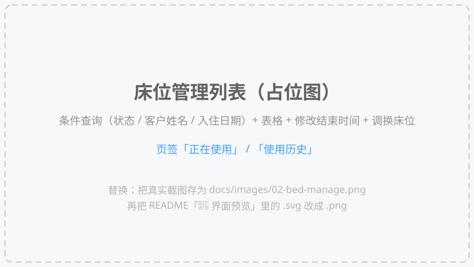
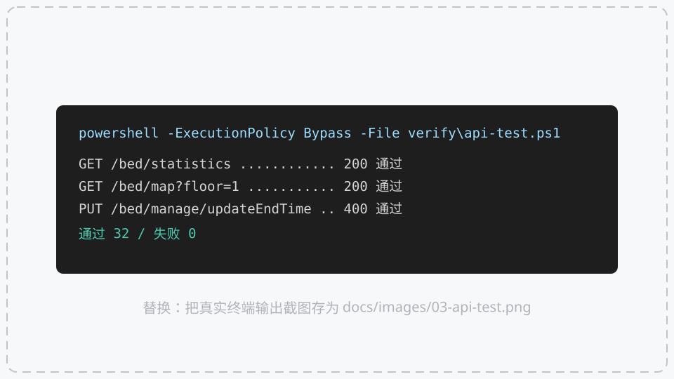

# 东软颐养中心 —— 床位管理模块

[](Bed%20Management/pom.xml) [](Bed%20Management/pom.xml) [](Bed%20Management/pom.xml) [](Bed%20Management/src/main/resources/application.yml)
[](care-center-ui-main/package.json) [](care-center-ui-main/package.json) [](care-center-ui-main/package.json) [](care-center-ui-main/package.json) [](verify/api-test.ps1)

本目录是「床位管理」模块的完整交付物，包含 **Spring Boot 后端** 和 **复用已有的 Vue 前端**。

> 🤝 **要把本模块和别人做的模块合并？先看 [`MERGE.md`](MERGE.md)** —— 里面列了「组长必须拉取的文件清单」、「放哪里」、「必须改的配置」、「10 个冲突风险点」和「合并后 5 步验收」，照着做即可。

```
d:\床位管理（2）
├── Bed Management\          # 后端（Spring Boot 3 + MyBatis-Plus）
├── care-center-ui-main\     # 前端（Vue 3 + Element Plus + Vite）
├── verify\                  # 接口自测脚本（api-test.ps1，32 项断言）
├── docs\images\             # 界面截图（README 顶部「📸 界面预览」用的图）
├── settings.xml             # Maven 阿里云镜像配置（可选，构建时 -s 指定）
├── Show.md                  # 📖 项目讲解手册：每个文件干啥用 + 前后端如何串起来（零基础也能看懂）
├── MERGE.md                 # 🤝 合并交付清单：必须拉取哪些文件 + 合并步骤 + 冲突风险点
└── README.md                # 本文件
```

> 📎 **另：本文件后半部分是一份「零基础复习手册」**（从第 0 节到第 19 节，约 2400 行），
> 把本次开发用到的**所有知识点**（Java / Spring Boot / HTTP / 数据库 / MyBatis-Plus / 事务 / 日期时区 / Vue 3 / Element Plus / axios / Vite / 中文乱码 / 命令行 / 排错方法 / 8 个真实踩坑复盘 / 名词速查表 / 30 道自测题）
> 🚀 **只想赶紧跑起来？看这里**（本仓库**不含** `target/` 和 `node_modules/`，克隆后需要自己构建一次）
>
> ```bash
> # 环境要求：JDK 17+、Maven 3.9+、Node 20.19+（Vite 8 要求 ^20.19.0 || >=22.12.0；MySQL 8 可选，不装也能用 H2 演示模式跑通全部接口）
>
> # ① 启动后端（H2 内存库演示模式，零配置、不用装 MySQL）
> cd "Bed Management"
> mvn -s ..\settings.xml clean package -DskipTests
> java -jar target/bed-management-1.0.0.jar --spring.profiles.active=h2
> #   → 接口地址   http://localhost:8080/api
> #   → 接口文档   http://localhost:8080/api/swagger-ui/index.html
> #   → H2 控制台  http://localhost:8080/api/h2-console
> #     JDBC URL: jdbc:h2:mem:yiyang;MODE=MySQL;DB_CLOSE_DELAY=-1   用户: sa   密码: 空
>
> # ② 启动前端（另开一个终端窗口）
> cd care-center-ui-main
> npm install
> npm run dev
> #   → 浏览器打开 http://localhost:5173 ，左侧菜单进「床位示意图」/「床位管理」
>
> # ③ 一键自测（可选，会把 5 个接口连失败分支一起跑 32 项断言）
> powershell -ExecutionPolicy Bypass -File verify\api-test.ps1
> ```
>
> 想用 MySQL（正式交付方式）？见下面 **「三、怎么跑起来」**；想用 H2 演示？见 **「四、没有 MySQL 时怎么演示」**。

---

## 📸 界面预览

下面 3 张图**目前是占位图**——仓库里不放假截图，占位图上也直接写清了该位置应该显示什么。
你本地把项目跑起来后，照 [`docs/images/README.md`](docs/images/README.md) 的两步说明换成真实截图即可（`Win + Shift + S` 截图 → 存成 `01-bed-map.png` → README 里 `.svg` 改成 `.png` → `git commit && git push`）。

| 床位示意图（楼层 → 房间 → 床位三色状态） | 床位管理（条件查询 / 改结束时间 / 调换床位） |
| :---: | :---: |
|  |  |



---

# 第一部分 · 交付说明（快速上手看这里）

## 一、需求实现对照

| 需求 | 实现 | 位置 |
| --- | --- | --- |
| 床位示意图（按楼层展示房间与床位状态） | `GET /api/bed/map?floor=1` 返回该楼层每个房间下的床位列表 | `BedController#bedMap` + `BedServiceImpl#listRoomBeds` |
| 床位状态统计 | `GET /api/bed/statistics` 返回总床位/空闲/有人/外出的数量 | `BedController#statistics` + `BedServiceImpl#statistics` |
| 床位管理列表（条件查询） | `GET /api/bed/manage/details?status=&customerName=&startDate=` | `BedController#details` + `BedManageServiceImpl#listDetails` |
| 修改床位结束时间（只改结束时间） | `PUT /api/bed/manage/updateEndTime` | `BedController#updateEndTime` + `BedManageServiceImpl#updateEndTime` |
| 床位调换（事务） | `POST /api/bed/manage/swap`：旧记录失效 + 旧床释放 + 新床占用 + 新增使用记录 + 同步客户房间/床位/楼号 | `BedController#swap` + `BedManageServiceImpl#swapBed` |

### 床位状态枚举

| 值 | 含义 | 前端颜色（`BedMap.vue` 里的 CSS 类） |
| --- | --- | --- |
| 1 | 空闲 | 绿色 `#67C23A`（`.status-free`） |
| 2 | 有人 | 蓝色 `#409EFF`（`.status-occupied`） |
| 3 | 外出 | 橙色 `#E6A23C`（`.status-out`） |

`beddetails.is_deleted` 表示业务状态：`0` = 当前正在使用的床位记录，`1` = 历史记录（已退床/已调换）。**它不是 MyBatis-Plus 的逻辑删除字段**，所以实体上**没有**加 `@TableLogic`。

### 床位调换的业务规则

1. 只能办理「当天」的调换（`swapDate` 必须是今天）；
2. 目标床位必须存在、状态为「空闲」，且属于所选楼层/房间；
3. 旧记录置 `is_deleted = 1` 并写入 `end_date = 当天`；
4. 旧床位置为「空闲」，新床位置为「有人」；
5. 新增一条 `is_deleted = 0` 的床位使用记录；
6. 同步更新 `customer` 表中的房间号、床位号、楼号；
7. 以上步骤在同一个 `@Transactional` 事务里，任一步失败全部回滚。

---

## 二、接口清单

统一响应格式：

```json
{ "code": 200, "msg": "操作成功", "data": {} }
```

`code === 200` 表示成功；失败时返回 **HTTP 400**，响应体里的 `code` 同样是 400，错误原因放在 `msg` 里，前端用 `error.response.data.msg` 就能直接弹提示（本模块前端就是这么做的）。

| 方法 | 路径 | 参数 | 说明 |
| --- | --- | --- | --- |
| GET | `/api/bed/statistics` | 无 | 床位统计 `{total, free, occupied, out}` |
| GET | `/api/bed/map` | `floor` 楼层号 | 床位示意图数据（房间 + 床位） |
| GET | `/api/bed/manage/details` | `status`（**1 正在使用（默认）** / 0 使用历史）、`customerName`（模糊）、`startDate`（该日期及以后入住） | 床位管理列表 |
| PUT | `/api/bed/manage/updateEndTime` | body `{ "id": 1, "endDate": "2026-03-01" }` | 修改结束时间 |
| POST | `/api/bed/manage/swap` | body `{ "customerId":1, "newFloor":"1", "newRoomNo":101, "newBedId":4, "swapDate":"2026-10-10" }` | 床位调换 |

> 注意：后端 `server.servlet.context-path` 是 `/api`，前端 axios 的 `baseURL` 也是 `/api`，Vite 开发代理会把 `/api` 转发到 `http://localhost:8080`，所以前端代码里写的是 `/bed/statistics` 这样的相对路径，不需要改。

---

## 三、怎么跑起来

### 1. 建库 + 导入演示数据（MySQL）

用 Navicat / 命令行执行 `Bed Management\sql\yiyang_bed.sql`：

```bash
mysql -uroot -p < "Bed Management/sql/yiyang_bed.sql"
```

脚本会创建数据库 `yiyang`、4 张表（`room` / `bed` / `beddetails` / `customer`）并写入演示数据：
一层 101~106、二层 201~206 共 12 个房间、48 张床位（空闲 40 / 有人 6 / 外出 2）、8 位已入住老人。

数据库连接在 `Bed Management\src\main\resources\application.yml`：

```yaml
spring:
  datasource:
    url: jdbc:mysql://localhost:3306/yiyang?useUnicode=true&characterEncoding=utf8&serverTimezone=Asia/Shanghai&useSSL=false&allowPublicKeyRetrieval=true
    username: root
    password: root      # ← 改成你自己的密码
```

### 2. 启动后端

```bash
cd "Bed Management"
mvn -s ..\settings.xml clean spring-boot:run
```

或者用 IDEA 打开 `Bed Management` 目录，直接运行 `BedManagementApplication`。

启动后：
- 接口地址：`http://localhost:8080/api`
- 接口文档（Swagger UI）：`http://localhost:8080/api/swagger-ui/index.html`

### 3. 启动前端

```bash
cd care-center-ui-main
npm install     # 已经装过可跳过
npm run dev
```

浏览器打开终端里提示的地址（默认 `http://localhost:5173`），左侧菜单进入「床位示意图」和「床位管理」。

---

## 四、没有 MySQL 时怎么演示（H2 内存库）

项目内置了一个 `h2` profile，用 H2 内存库 + 自动建表脚本，**不需要装 MySQL** 就能跑通全部接口：

```bash
cd "Bed Management"
mvn -s ..\settings.xml spring-boot:run -Dspring-boot.run.profiles=h2
```

或者打包后运行：

```bash
java -jar target/bed-management-1.0.0.jar --spring.profiles.active=h2
```

- 建表脚本：`src/main/resources/db/h2-schema.sql`
- 演示数据：`src/main/resources/db/h2-data.sql`
- H2 控制台：`http://localhost:8080/api/h2-console`，JDBC URL `jdbc:h2:mem:yiyang;MODE=MySQL;DB_CLOSE_DELAY=-1`，用户名 `sa`，密码留空。

---

## 五、常见问题

**Q：前端请求报 400，`msg` 是「只能当天办理床位调换」？**
A：调换接口只允许办理当天的调换，前端传的 `swapDate` 必须是本地时区的今天（`yyyy-MM-dd`）。

**Q：日期查询差一天？**
A：`el-date-picker` 必须加 `value-format="YYYY-MM-DD"`，否则 `v-model` 是 `Date` 对象，序列化成 UTC 字符串后会少一天。本模块前端已经加好了。

**Q：床位管理列表打开是空的？**
A：默认页签是「正在使用」。如果确实没有在住的床位记录，切到「使用历史」页签，或者执行 SQL 脚本重新导入演示数据。

**Q：`beddetails.is_deleted` 为什么不用 `@TableLogic`？**
A：这个字段在业务上是「这条使用记录是否已结束」的意思，需要能被查询出来（使用历史页签要查 `is_deleted = 1`），用逻辑删除会让历史记录查不到，所以一律用显式条件查询。

**Q：想在手机上打开 `http://localhost:5173/` 演示，打不开怎么办？**
A：`localhost` 在手机上指**手机自己**，永远连不到你的电脑，必须换成电脑的局域网 IP。`vite.config.js` 已配置 `host: true`（监听所有网卡），所以只要：① `ipconfig` 看 WLAN 的 IPv4 地址（例如 `10.104.223.138`）→ ② 手机连**同一个 Wi-Fi** → ③ 浏览器打开 `http://10.104.223.138:5173/`。
三个注意点：**一是** Windows 防火墙要允许 Node.js（首次运行 `npm run dev` 会弹窗，选「允许访问」即可）；**二是** 有些校园网/公共 Wi-Fi 开了「客户端隔离」，手机和电脑互相都 ping 不通，这种网络下手机访问不了，可让电脑连手机热点来演示；**三是** 后端**不用改任何配置**，手机发的 `/api` 请求会走 Vite 代理，由电脑转发给 `localhost:8080`。

---

## 六、接口自测脚本（32 项断言）

`verify\api-test.ps1` 会把 5 个接口（含各种失败分支）全部跑一遍，输出每一项的 HTTP 状态码、响应体和通过情况：

```powershell
# 1) 先启动后端（h2 演示模式）
java -jar "Bed Management\target\bed-management-1.0.0.jar" --spring.profiles.active=h2

# 2) 再跑自测
powershell -ExecutionPolicy Bypass -File verify\api-test.ps1
```

覆盖范围：

| 接口 | 覆盖点 |
| --- | --- |
| `GET /bed/statistics` | 总数 48 / 空闲 40 / 有人 6 / 外出 2 |
| `GET /bed/map` | 一层 6 房间、二层 6 房间、不存在楼层返回空数组、调换后床位状态变化 |
| `GET /bed/manage/details` | 默认「正在使用」、`status=0/1` 页签切换、姓名模糊、入住日期、组合条件、查不到返回空数组 |
| `PUT /bed/manage/updateEndTime` | 成功；结束时间早于入住时间、记录不存在、id 为空、日期格式非法、ISO 日期兼容 |
| `POST /bed/manage/swap` | 成功；非当天、目标床位非空闲、床位不在所选楼层/房间、客户不存在、目标床位不存在 |

> 脚本最后的 `通过 N 项，失败 0 项`；只要有失败项，退出码就是 1（方便接到 CI 里）。
> 注意：调换用例会真的改数据，建议在 h2 内存库上跑。

---
---

# 🎓 第二部分 · 复习手册（零基础友好版）

> 这一部分不是"交付说明"，而是**把这次做床位管理模块用到的所有知识点，从零讲一遍**。
> 每一节的结构都是：**这是什么 → 为什么需要 → 本项目哪里用到（给文件名/代码行）→ 踩过的坑**。
> 建议按顺序读；每节结尾的「你应该能回答」是用来检验自己的。

## 目录

| 节 | 内容 | 难度 |
| --- | --- | --- |
| [0](#0-先看懂全局一个项目到底由什么组成) | 先看懂全局：一个项目到底由什么组成 | ⭐ |
| [1](#1-java-基础本项目真正用到的部分) | Java 基础（本项目真正用到的部分） | ⭐ |
| [2](#2-spring-boot从-0-到能启动) | Spring Boot：从 0 到能启动 | ⭐⭐ |
| [3](#3-http-与-rest-接口后端到底在对外提供什么) | HTTP 与 REST 接口 | ⭐⭐ |
| [4](#4-统一响应格式--全局异常处理) | 统一响应格式 + 全局异常处理 | ⭐⭐ |
| [5](#5-参数校验与-dto--vo--entity-三种模型) | 参数校验 + DTO / VO / Entity | ⭐⭐ |
| [6](#6-数据库与-sql-4-张表背后的设计) | 数据库与 SQL（4 张表背后的设计） | ⭐⭐ |
| [7](#7-mybatis-plus-让-java-操作数据库) | MyBatis-Plus：让 Java 操作数据库 | ⭐⭐⭐ |
| [8](#8-事务-数据不能改一半) | 事务：数据不能改一半 | ⭐⭐⭐ |
| [9](#9-日期与时间为什么总是差一天) | 日期与时间：为什么总是"差一天" | ⭐⭐⭐ |
| [10](#10-业务设计把需求翻译成代码) | 业务设计：把需求翻译成代码 | ⭐⭐⭐ |
| [11](#11-vue-3-前端基础) | Vue 3 前端基础 | ⭐⭐ |
| [12](#12-element-plus--axios--vite前端三件套) | Element Plus / axios / Vite | ⭐⭐ |
| [13](#13-中文乱码专题) | 中文乱码专题 | ⭐⭐ |
| [14](#14-命令行与工具链速查) | 命令行与工具链速查 | ⭐⭐ |
| [15](#15-排查问题的固定套路) | 排查问题的固定套路 | ⭐⭐⭐ |
| [16](#16-踩坑复盘8-个真实-bug-的完整思路) | 踩坑复盘：8 个真实 bug 的完整思路 | ⭐⭐⭐⭐ |
| [17](#17-名词速查表中英对照) | 名词速查表（中英对照） | ⭐ |
| [18](#18-自测题30-题带答案) | 自测题（30 题带答案） | ⭐⭐⭐ |
| [19](#19-接下来还能学什么) | 接下来还能学什么 | — |

---

## 0. 先看懂全局：一个项目到底由什么组成

### 0.1 一句话概括

这个项目就是一套 **「浏览器页面 ↔ 后端接口 ↔ 数据库」** 的三层结构：

```
   ┌────────────────────────┐        ┌──────────────────────────┐        ┌───────────────┐
   │  浏览器（前端）          │  HTTP  │  后端（Spring Boot）      │  JDBC  │  数据库        │
   │  Vue 3 + Element Plus   │ ─────► │  Controller/Service/     │ ─────► │  MySQL / H2   │
   │  http://localhost:5174  │  JSON  │  Mapper（Java 代码）      │  SQL   │  4 张表        │
   └────────────────────────┘        └──────────────────────────┘        └───────────────┘
```

- **前端**只管"长什么样、点了以后发什么请求"；
- **后端**只管"收到请求后做什么业务、怎么读写数据库"；
- **数据库**只管"数据存哪儿"。

三者之间靠两个约定连接：**HTTP 协议 + JSON 格式**（前后端之间），**SQL 语句 + JDBC 驱动**（后端与数据库之间）。

### 0.2 一次点击的完整链路（必须背下来）

以"在床位管理页面点【床位调换】并确认"为例：

| 步骤 | 发生在哪 | 具体做了什么 | 对应文件 |
| --- | --- | --- | --- |
| 1 | 浏览器 | 用户填完表单点"确认调换"，Vue 执行 `submitSwap()` | `BedManage.vue` L174 |
| 2 | 浏览器 | axios 把 `swapForm` 对象转成 JSON，用 **POST** 发到 `/api/bed/manage/swap` | `BedManage.vue` L177 |
| 3 | 网络 | Vite 开发服务器的**代理**发现路径以 `/api` 开头，转发给 `http://localhost:8080` | `vite.config.js` L11-16 |
| 4 | 后端 | Tomcat 收到请求，因为有 `context-path: /api`，匹配到 `BedController#swap` | `application.yml` L10 |
| 5 | 后端 | 框架把请求体 JSON **反序列化**成 `BedSwapDTO` 对象，并执行 `@Valid` 校验 | `BedController` L73 |
| 6 | 后端 | 调用 `bedManageService.swapBed(dto)` 执行真正的业务（一堆 if 校验） | `BedManageServiceImpl` L107 |
| 7 | 后端 | MyBatis-Plus 把 Java 操作翻译成 SQL，通过 JDBC 发给数据库；整个方法被 `@Transactional` 包着 | `BedManageServiceImpl` L106 |
| 8 | 数据库 | 执行 `UPDATE beddetails ...` / `UPDATE bed ...` / `INSERT INTO beddetails ...` / `UPDATE customer ...` | `h2-schema.sql` 里的表结构 |
| 9 | 后端 | 全部成功 → 返回 `Result.success("床位调换成功", null)`；任何一步抛 `BusinessException` → 被全局异常处理器接住，返回 HTTP 400 | `GlobalExceptionHandler` |
| 10 | 前端 | axios 收到 HTTP 200 → 弹绿色 `ElMessage.success`（收到 400 → `catch` 里弹红色提示） | `BedManage.vue` L177-181 |
| 11 | 浏览器 | 重新调用 `fetchDetails()` 刷新表格，页面数据变化 | `BedManage.vue` L180 |

**看懂这张表，就看懂了整个 Web 开发。** 后面所有知识点都是在给这张表的某一格"填细节"。

### 0.3 后端目录结构为什么这样分

```
Bed Management/src/main/
├── java/com/neusoft/yiyang/
│   ├── BedManagementApplication.java   ← 启动类（程序入口，main 方法在这）
│   ├── controller/    BedController        ← 门卫：只负责"收参数、转交、返回"
│   ├── service/       BedService / BedManageService        ← 接口：定义"能做什么"
│   │   └── impl/      BedServiceImpl / BedManageServiceImpl ← 实现：真正的业务逻辑与 if 校验
│   ├── mapper/        BedMapper / BedDetailsMapper ...      ← 数据访问层：只负责"跟数据库打交道"
│   ├── entity/        Bed / BedDetails / Room / Customer    ← 数据库表的 Java 映射（字段一一对应）
│   ├── dto/           BedSwapDTO ...       ← 前端"传进来"的参数对象
│   ├── vo/            BedDetailsVO ...     ← 后端"返回出去"的数据对象
│   ├── common/        Result / ResultCode / BusinessException / 全局异常处理器 / 状态常量
│   ├── config/        WebMvcConfig（跨域）/ OpenApiConfig（接口文档）
│   └── util/          DateUtils（日期工具）
└── resources/
    ├── application.yml / application-h2.yml  ← 配置（端口、数据库、MyBatis）
    ├── mapper/*.xml                          ← 手写 SQL 放这里
    └── db/h2-schema.sql / h2-data.sql        ← H2 演示用的建表 + 造数据脚本
```

**为什么要分这么多层？** 想象把"查床位列表"的 SQL、业务判断、HTTP 参数解析全写在一个类里：改个字段名要动全文件、没法复用、别人读不懂。分层就是为了**每层只操心一件事**（这叫"关注点分离"）。面试常问的 "MVC 三层架构" 就是这个。

### 0.4 你需要装的环境（以及它们分别管什么）

| 工具 | 作用 | 验证命令 |
| --- | --- | --- |
| JDK | 把 `.java` 编译成 `.class`，并运行 Java 程序 | `java -version` |
| Maven | 下载第三方库（jar 包）、编译、打包 | `mvn -v` |
| Node.js / npm | 运行前端构建工具 Vite | `node -v`、`npm -v` |
| MySQL | 真正存数据的数据库（可选，用 H2 可跳过） | 见第 6 节 |
| VS Code / IDEA | 写代码 | — |

---

## 1. Java 基础（本项目真正用到的部分）

> 学 Java 最大的陷阱是"从第一章看到第十章，一个项目都写不出来"。这里只讲**这个项目里真实出现过的语法**，看完就能读懂全部后端代码。

### 1.1 package 与 import

```java
package com.neusoft.yiyang.controller;   // 我这个文件属于哪个"命名空间"

import com.neusoft.yiyang.common.Result; // 我要用别的包里的类，得先 import
```

- `package` 必须和**文件夹路径**一致（`com.neusoft.yiyang` → `java/com/neusoft/yiyang/`），包名习惯用公司域名倒着写。
- 同一个包里互相调用**不用** import；`java.lang.*`（String、Integer…）也不用。

### 1.2 类、接口、继承、实现（4 个关键字）

```java
public interface BedService {            // 接口：只写"能做什么"，不写怎么做
    BedStatisticsVO statistics();
}

@Service
public class BedServiceImpl implements BedService {   // 实现类：真正写逻辑
    @Override                                        // 声明"我这是重写接口的方法"
    public BedStatisticsVO statistics() { /* ... */ }
}
```

- `implements` = 实现接口；`extends` = 继承父类。
- 本项目里 `BedDetailsMapper extends BaseMapper<BedDetails>`，意思是"白捡了 BaseMapper 里几十个增删改查方法"，不用自己写。
- **为什么要接口 + 实现分开？** Controller 里只声明 `private final BedService bedService;`，并不知道也不关心具体实现是谁。这叫**面向接口编程**，将来换实现不用改 Controller。

### 1.3 访问修饰符 & static & final

| 写法 | 含义 | 本项目例子 |
| --- | --- | --- |
| `private` | 只有本类能访问 | 所有 Entity/DTO/VO 的字段 |
| `public` | 谁都能访问 | Controller 的接口方法 |
| `static` | **属于类**，不属于某个对象，用 `类名.方法()` 直接调 | `Result.success(...)`、`DateUtils.parse(...)` |
| `final` | 不可改变 | `private final BedService bedService`（注入后不允许换人） |

关于 `static` 的直观理解：`Result.success(data)` 这种写法前面是**类名**不是对象名，说明它是静态方法。

```java
public final class DateUtils {      // 工具类：final 表示"不允许被继承"
    private DateUtils() { }         // 构造器私有：不允许 new，只能 DateUtils.xxx() 调用
}
```

### 1.4 注解（Annotation）：@ 后面那些东西到底是什么

**注解本身不干活**，它只是给代码贴的"标签"。真正干活的是**读标签的人（框架）**。

| 注解 | 贴在哪 | 谁来读它 / 读它做什么 |
| --- | --- | --- |
| `@SpringBootApplication` | 启动类 | Spring：从本包开始扫描所有 Bean |
| `@RestController` | 类 | Spring MVC：这个类的方法返回值直接变成 JSON |
| `@GetMapping("/map")` | 方法 | Spring MVC：把 `GET /api/bed/map` 交给它 |
| `@Service` | 类 | Spring：把这个类做成一个 Bean（默认单例）放进容器 |
| `@Data` | 类 | **Lombok（编译期）**：自动生成 getter/setter/toString/equals |
| `@Slf4j` | 类 | Lombok：生成 `log` 对象，就能直接 `log.info(...)` |
| `@TableName("beddetails")` | 类 | MyBatis-Plus：这个类对应哪张表 |
| `@TableId(type = IdType.AUTO)` | 字段 | MyBatis-Plus：这是主键，且数据库自增 |
| `@NotNull(message="...")` | 字段 | Hibernate Validator：校验不过就报这条消息 |
| `@Transactional` | 方法 | Spring：给这个方法套一层事务（第 8 节详讲） |
| `@Schema(description="...")` | 类/字段 | springdoc：生成 Swagger 文档时显示这段说明 |

> 💡 **小白最容易懵的点**：`@Data` 之后代码里明明没写 `getBedStatus()`，编译却能通过。因为 Lombok 是一个"**注解处理器**"，它在**编译阶段**替你生成了这些方法（生成在 `.class` 文件里，源码里看不到）。所以一旦它没生效，编译器就会报「找不到符号 getBedStatus()」——我们在第 16 节踩过这个坑。

### 1.5 泛型 `<T>`：为什么到处是尖括号

```java
public class Result<T> {         // T 是"占位符"，用的时候再决定具体类型
    private T data;
}
Result<BedStatisticsVO> r1 = Result.success(statistics);  // 这里 T = BedStatisticsVO
Result<List<RoomBedsVO>> r2 = Result.success(list);        // 这里 T = List<RoomBedsVO>
```

好处：**一个类能装任何数据，同时编译期就能检查类型**。不用泛型就得写 `Object data`，取出来还得强转，非常容易出错。

### 1.6 异常：throw / try-catch / 为什么自定义异常

```java
// Service 里"发现问题"就这么写：抛出去，交给上层处理
if (newBed == null) {
    throw new BusinessException("目标床位不存在，床位ID：" + dto.getNewBedId());
}
```

- `RuntimeException`（**非受检异常**）不需要在方法签名上声明 `throws`，可以一路往上抛 —— `BusinessException extends RuntimeException` 就是这个原因，Service 才能写得这么干净。
- 谁接住它？`GlobalExceptionHandler` 里的 `@ExceptionHandler(BusinessException.class)`（第 4 节）。
- **为什么要自定义异常**？为了能被"单独识别"：业务失败（400）和代码 bug（500）要区别对待。

### 1.7 包装类与 null：`Integer` vs `int`

```java
private Integer id;      // 对象，可以是 null（"没有这个值"）
private int count;       // 基本类型，永远有值（默认 0）

// 比较两个包装类是否相等，必须用 equals，不能用 ==（第 16 节有真实案例）
if (!Integer.valueOf(BedStatus.FREE).equals(newBed.getBedStatus())) { /* ... */ }
```

- `==` 比的是"是不是同一个对象"，`Integer` 只在 -128~127 之间有缓存，超出就 false，所以**包装类比较永远用 equals**。
- 数据库字段可能为 NULL，所以实体类里一律用包装类型 `Integer`，不用 `int`。

### 1.8 Stream 与 Lambda：一行写完"遍历 + 筛选 + 分组"

```java
// BedServiceImpl#listRoomBeds 里：把床位按房间号分组
Map<Integer, List<Bed>> bedGroup = beds.stream().collect(Collectors.groupingBy(Bed::getRoomNo));

// 把房间列表的 roomNo 抽出来变成 List<Integer>
List<Integer> roomNos = rooms.stream().map(Room::getRoomNo).collect(Collectors.toList());

// 前端 BedManage.vue 里的同类写法（JS 的 filter）
freeBedOptions.value = room.beds.filter(b => b.bedStatus === 1)
```

- `x -> ...` 或 `类名::方法名` 就是 **Lambda / 方法引用**，本质是"把一段代码当参数传进去"。
- `stream()` 把集合变成"流水线"，`map`（转换）、`filter`（筛选）、`collect`（收集）、`groupingBy`（分组）就是流水线上的工序。
- **不熟也没关系**：它等价于一个 for 循环 + if + 往新集合里 add。

### 1.9 你应该能回答

1. `@Service` 和 `@RestController` 分别是谁在读？读了做什么？
2. `private final BedService bedService;` 为什么加了 final 还能有值？
3. `BedDetailsMapper extends BaseMapper<BedDetails>` 之后，哪些方法是"白捡的"？
4. 为什么实体类字段用 `Integer` 而不用 `int`？
5. 为什么比较两个 `Integer` 不能用 `==`？

---

## 2. Spring Boot：从 0 到能启动

### 2.1 Spring 到底解决什么问题

假设没有 Spring，你要自己 `new BedController(new BedServiceImpl(new BedDetailsMapper(...)))` 一层层拼装，还要管理谁先谁后。**Spring 的核心工作就是"帮你 new 对象 + 帮你管对象"**，这套机制叫 **IoC 容器**（控制反转）或 **DI 依赖注入**。

它替你做两件事：

1. 扫描你的注解（`@Service`、`@RestController`、`@Mapper`…），把类**造好对象**存进容器（这些对象叫 **Bean**）；
2. 看到某个类里写着 `private final BedService bedService;`，就**自动把容器里那个对象塞进去** —— 这就是**依赖注入**，你一个 `new` 都不用写。

```java
@Service
@RequiredArgsConstructor        // ← Lombok：为所有 final 字段生成一个构造器
public class BedManageServiceImpl implements BedManageService {
    private final BedDetailsMapper bedDetailsMapper;   // ← Spring 通过这个构造器把它注入进来
```

> 为什么用 `@RequiredArgsConstructor` + `final` 而不是 `@Autowired`？因为构造器注入有三大好处：字段可以声明 final、依赖不会为 null、单元测试时直接 new 就能传假对象（这也叫"最佳实践"，Spring 官方推荐）。

### 2.2 启动类：程序从哪里开始

```java
@SpringBootApplication      // = @Configuration + @EnableAutoConfiguration + @ComponentScan 三个注解的合体
@MapperScan("com.neusoft.yiyang.mapper")   // 扫描 Mapper 接口，替它们生成实现类
public class BedManagementApplication {
    public static void main(String[] args) {
        SpringApplication.run(BedManagementApplication.class, args);
    }
}
```

`main` 方法执行后发生了什么（启动日志就是这几个阶段）：

1. 创建 Spring 容器 → 2. 自动配置（读到 `spring-boot-starter-web` 就自动准备好内嵌 **Tomcat**）→ 3. 扫描本包下所有 Bean → 4. 读 `application.yml` → 5. 启动 Tomcat 监听 8080 端口 → 6. 打印 `Started BedManagementApplication in 2.9 seconds`。

**你能看到这行日志，就说明后端起来了。**

### 2.3 application.yml：配置比代码先跑

YAML 用**缩进**表示层级（**只能用空格，不能用 Tab**，缩进错了启动就报错）：

```yaml
server:
  port: 8080                 # 服务器端口
  servlet:
    context-path: /api       # 所有接口统一加前缀 /api
spring:
  datasource:
    url: jdbc:mysql://localhost:3306/yiyang?...   # 数据库连接串
    username: root
    password: 123456
mybatis-plus:
  mapper-locations: classpath*:/mapper/**/*.xml   # 手写 SQL 的位置
```

几个必须记住的点：

- **`context-path: /api`** 是"整个应用的前缀"。`BedController` 上写 `@RequestMapping("/bed")` + `@GetMapping("/statistics")`，真实地址就是 `http://localhost:8080/api/bed/statistics`。**前端 axios 的 `baseURL='/api'` 正好对上，缺一个都 404。**
- `password: 123456` 这种敏感信息真实项目要放到环境变量或密钥管理里，不能提交到 Git（学习阶段先这样）。
- 配置项的读取方式有三种：`@Value("${yiyang.building-no:606}")`（单个值，冒号后面是**默认值**）、`@ConfigurationProperties`（批量绑定，本项目没用）、`Environment.getProperty()`。

### 2.4 profile：一套代码，多套环境配置

**问题**：交付时用 MySQL，但没装 MySQL 的电脑上想跑起来看效果，怎么办？

**答案**：把"默认配置"和"某个环境的差异配置"分成两个文件，用 `profile` 激活：

| 文件 | 什么时候生效 | 内容 |
| --- | --- | --- |
| `application.yml` | **永远生效**（基础配置） | 端口、context-path、MyBatis、Swagger |
| `application-h2.yml` | 只在激活 `h2` 时生效，**覆盖**同名配置 | 换成 H2 内存库 + 自动执行建表/造数据脚本 |

```bash
java -jar target/bed-management-1.0.0.jar --spring.profiles.active=h2   # 用 H2
java -jar target/bed-management-1.0.0.jar                             # 用 MySQL（默认）
```

**优先级**：`application-{profile}.yml` > `application.yml` > 代码里的默认值。这条规则在任何项目里都通用。

### 2.5 Spring Boot 常见注解速查（本项目出现过的）

```java
@Configuration          // 这是一个配置类（WebMvcConfig 用它注册跨域）
@Bean                   // 交给 Spring 管理的方法返回值（OpenApiConfig 用它注册文档信息）
@Service                // 业务层 Bean
@RestController         // = @Controller + @ResponseBody，返回值直接转 JSON
@Mapper                 // 这是 MyBatis 的 Mapper 接口
@MapperScan("包名")      // 批量扫描 Mapper，省得每个接口都写 @Mapper
@RequiredArgsConstructor// Lombok：生成包含所有 final 字段的构造器（用于依赖注入）
@Value("${key:default}")// 从配置里读一个值
```

### 2.6 你应该能回答

1. 加了 `@Service` 的类，是谁、在什么时候 `new` 出来的？
2. `private final BedService bedService;` 的值是从哪来的？
3. 为什么不推荐 `@Autowired` 写在字段上？
4. `context-path: /api` + `@RequestMapping("/bed")` + `@GetMapping("/map")`，最终访问地址是什么？
5. 想让 H2 配置生效，命令行参数怎么写？

---

## 3. HTTP 与 REST 接口（后端到底在对外提供什么）

### 3.1 一个请求由什么构成

```
GET /api/bed/manage/details?status=1&customerName=张 HTTP/1.1     ← 请求行：方法 + 路径 + 查询串
Host: localhost:8080                                             ← 请求头 Header
Content-Type: application/json                                   ← 请求头：我发的是 JSON

{ "id": 1, "endDate": "2026-03-01" }                             ← 请求体 Body（GET 一般没有）
```

- **方法**：GET（查）、POST（新增/提交）、PUT（修改）、DELETE（删除）。
- **查询参数 Query**：拼在 URL 问号后面，`?key=value&key2=value2`，后端用 `@RequestParam` 接。
- **路径参数 PathVariable**：`/bed/1` 里的 `1`，后端用 `@PathVariable` 接（本项目没用到）。
- **请求体 Body**：POST/PUT 把数据放在 body 里，后端用 `@RequestBody` 接。

### 3.2 本项目 5 个接口对照（背下来）

| 方法 | 路径 | 参数怎么传 | Controller 写法 |
| --- | --- | --- | --- |
| GET | `/api/bed/statistics` | 无参数 | `@GetMapping("/statistics")` + 无参方法 |
| GET | `/api/bed/map?floor=1` | Query | `@RequestParam(value="floor", defaultValue="1") String floor` |
| GET | `/api/bed/manage/details?status=1&customerName=张&startDate=2025-01-01` | Query，**自动装进对象** | 方法参数直接写 `BedDetailsQueryDTO query`（Spring 会按字段名自动赋值） |
| PUT | `/api/bed/manage/updateEndTime` | Body JSON | `@PutMapping` + `@Valid @RequestBody UpdateEndTimeDTO dto` |
| POST | `/api/bed/manage/swap` | Body JSON | `@PostMapping` + `@Valid @RequestBody BedSwapDTO dto` |

> 🔑 **重要细节**：GET 请求把参数写成对象（`BedDetailsQueryDTO query`）时**不需要** `@RequestBody`，Spring 会按"字段名 = 参数名"自动填。如果这里错写了 `@RequestBody`，参数就会全是 null（踩坑常见原因）。

### 3.3 HTTP 状态码（本项目的约定）

| 状态码 | 含义 | 本项目什么时候出现 |
| --- | --- | --- |
| 200 | 成功 | 正常返回 `{code:200, msg:"操作成功", data:...}` |
| 400 | 客户端请求有问题 | 业务校验失败（如结束时间早于入住时间）、参数校验失败（`@NotNull`） |
| 404 | 路径不存在 | 接口地址写错、`context-path` 忘了加 `/api` |
| 500 | 服务器内部错误 | 代码抛了没预料到的异常（空指针等） |

### 3.4 Swagger / OpenAPI：不用 Postman 也能测接口

`@Tag`、`@Operation`、`@Schema` 这些注解平时不影响运行，它们的唯一作用是**生成在线接口文档**：

- 打开 `http://localhost:8080/api/swagger-ui/index.html`
- 能看到 5 个接口、每个参数的含义和示例值，点「Try it out」可以直接发请求。
- 好处：前端同学不用看你的代码就知道怎么调；联调时吵架减少 80%。

### 3.5 你应该能回答

1. GET 和 POST 的区别是什么？（提示：语义、参数位置、幂等性）
2. `@RequestParam`、`@PathVariable`、`@RequestBody` 分别对应请求的哪一部分？
3. 前端访问 `/api/bed/map` 报 404，可能有哪些原因？
4. Swagger 文档地址是什么？它是靠什么生成的？

---

## 4. 统一响应格式 + 全局异常处理

### 4.1 为什么要"统一响应格式"

如果每个接口各返回各的（有的返回数组、有的返回对象、出错返回字符串），前端就得为每个接口写一套解析逻辑。所以团队约定：**所有接口都返回同一个外壳**：

```json
{ "code": 200, "msg": "操作成功", "data": [ ... 真正的业务数据 ... ] }
```

对应代码就是 `Result<T>` 这个类（`common/Result.java`）：

```java
public static <T> Result<T> success(T data) { return new Result<>(ResultCode.SUCCESS, "操作成功", data); }
public static <T> Result<T> error(Integer code, String msg) { return new Result<>(code, msg, null); }
```

Controller 里只有两种写法：

```java
return Result.success(bedService.statistics());        // 成功，带数据
return Result.success("修改成功", null);                 // 成功，无数据
```

`code` 的取值定义在 `ResultCode`（接口常量）：`200 成功`、`400 业务失败`、`500 系统异常`。

### 4.2 全局异常处理：为什么 Service 里可以"随便抛"

`BedManageServiceImpl` 里到处是 `throw new BusinessException("只能调换到空闲的床位")`，但前端却能收到整齐的 `{code:400, msg:"只能调换到空闲的床位"}`。中间发生了什么？

```java
@Slf4j
@RestControllerAdvice                     // ← 关键：这是一个"全局异常拦截器"
public class GlobalExceptionHandler {

    @ExceptionHandler(BusinessException.class)          // 抓到业务异常
    public ResponseEntity<Result<Void>> handleBusinessException(BusinessException e) {
        log.warn("业务异常：{}", e.getMessage());         // 记日志（方便排查）
        return ResponseEntity.badRequest()              // HTTP 400
                .body(Result.error(ResultCode.BAD_REQUEST, e.getMessage()));  // code 也是 400
    }

    @ExceptionHandler(MethodArgumentNotValidException.class)   // 抓到 @Valid 校验失败
    public ResponseEntity<Result<Void>> handleValidException(MethodArgumentNotValidException e) {
        String msg = e.getBindingResult().getFieldErrors().stream()
                .findFirst().map(f -> f.getDefaultMessage()).orElse("参数校验失败");
        return ResponseEntity.badRequest().body(Result.error(ResultCode.BAD_REQUEST, msg));
    }

    @ExceptionHandler(Exception.class)                  // 兜底：所有没预料到的异常
    public ResponseEntity<Result<Void>> handleException(Exception e) {
        log.error("系统异常", e);                          // 打完整堆栈，方便定位
        return ResponseEntity.status(HttpStatus.INTERNAL_SERVER_ERROR)
                .body(Result.error("系统异常，请稍后重试"));
    }
}
```

**它的价值**：业务代码从此不用写 try-catch、不用关心 HTTP 细节，只管"发现问题就抛"。这叫**横切关注点分离**。

### 4.3 ⭐ HTTP 状态码 vs 响应体里的 code（本次踩过的坑）

这是最容易搞混的一对概念：

| | HTTP 状态码 | 响应体里的 `code` |
| --- | --- | --- |
| 谁定的 | **HTTP 协议**规定 | **你们项目自己**约定的 |
| 前端怎么拿到 | `error.response.status` / axios 自动按 2xx 判断进 then 还是 catch | `res.data.code` |
| 本项目 | 200 成功 / 400 业务失败 / 500 异常 | 同上 |

**坑在哪**：一开始后端"业务失败"时返回的是 **HTTP 200 + `{code:500}`**。这样前端的 `axios.put(...)` 会走进 `then`（因为 HTTP 是 200），代码里写的是 `ElMessage.success('修改成功')`，**明明失败了却弹"修改成功"**！

修复方式：业务失败一律返回 **HTTP 400**，并且让响应体里的 `code` 也等于 400。于是前端：

```js
try {
  await axios.put('/bed/manage/updateEndTime', editForm)
  ElMessage.success('修改成功')                    // HTTP 200 → 走这里
} catch (error) {
  ElMessage.error(error.response?.data?.msg)       // HTTP 400 → 走这里，把后端的 msg 弹出来
}
```

> 📌 **一句话总结**：`code` 是给前端"看业务结果"的，HTTP 状态码是给前端"决定走 then 还是 catch"的，两者必须一致。
> 这也是一个通用的接口设计规范：**不要让 HTTP 200 承载失败语义**。

### 4.4 你应该能回答

1. `Result` 里的 `T` 是什么？为什么 `Result<Void>` 也是合法的？
2. `@RestControllerAdvice` + `@ExceptionHandler` 解决了什么重复劳动？
3. 如果后端失败时返回 HTTP 200，前端会出现什么 bug？
4. 为什么 500 的异常要 `log.error` 打全堆栈，而 400 只 `log.warn` 打消息？（提示：500 是"我的 bug"，要修；400 是"用户操作不对"，不用修）

---

## 5. 参数校验与 DTO / VO / Entity 三种模型

### 5.1 三种模型为什么要分开

同一个"床位使用记录"，在不同场合需要不同的字段集合：

| 名称 | 位置 | 作用 | 本项目例子 | 特点 |
| --- | --- | --- | --- | --- |
| **Entity**（实体） | `entity/` | **和数据库表一一对应** | `BedDetails` ↔ `beddetails` 表 | 字段 = 表字段，一个不多一个不少 |
| **DTO**（Data Transfer Object） | `dto/` | **接收前端传进来的参数** | `BedSwapDTO`、`UpdateEndTimeDTO` | 只包含"允许前端传的字段"，天然防篡改 |
| **VO**（View Object） | `vo/` | **返回给前端展示的数据** | `BedDetailsVO`、`BedStatisticsVO` | 可以包含多表拼出来的字段 |

**举例说明为什么必须分**：`beddetails` 表里有 `is_deleted` 字段，但前端调"调换"接口时**绝不允许**自己传 `is_deleted` 进来（否则可以随便伪造历史记录）。用了 `BedSwapDTO` 就自然做不到 —— 因为 DTO 里根本没这个字段。如果直接用 Entity 接收请求，就会多出一堆安全隐患。

`BedDetailsVO` 更是典型：它里面的 `customerName`、`customerSex` 来自 **customer 表**，是联查出来的，Entity 里根本没有。

### 5.2 Bean Validation：用注解声明"什么是合法的"

在校验 DTO 字段时，不用手写 `if (dto.getId() == null) throw ...`，在字段上贴注解即可：

```java
public class UpdateEndTimeDTO {
    @NotNull(message = "床位使用详情ID不能为空")     // 为 null 时校验失败，用这条消息
    private Integer id;

    @Schema(description = "结束时间，格式 yyyy-MM-dd")
    private String endDate;                          // 格式校验放 Service 里用 DateUtils 做
}
```

Controller 上加 `@Valid` 才会触发校验：

```java
@PutMapping("/manage/updateEndTime")
public Result<Void> updateEndTime(@Valid @RequestBody UpdateEndTimeDTO dto) { ... }
```

校验失败会抛 `MethodArgumentNotValidException` → 被 4.2 那个处理器抓成 **HTTP 400 + `{code:400, msg:"床位使用详情ID不能为空"}`**。

**常用校验注解**（备查）：`@NotNull`（不为空）、`@NotBlank`（字符串非空且不能是空格）、`@NotEmpty`（集合非空）、`@Min/@Max`、`@Size(min,max)`、`@Pattern(regexp="...")`、`@Email`、`@Future/@Past`（日期）。

**重要区分**：
- `@NotNull` 只判 null；`@NotBlank` 还会判空串和空格；
- **注解只负责"格式"，业务规则必须在 Service 里写**。比如"结束时间不能早于入住时间"依赖数据库里的入住时间，注解做不到，所以我们写在 `BedManageServiceImpl#updateEndTime` 里手写 if。

### 5.3 你应该能回答

1. DTO、VO、Entity 各是什么？为什么不能用一个类走天下？
2. `@Valid` 加在哪里才有用？不加会怎样？
3. `@NotNull` 和 `@NotBlank` 的区别？
4. "结束时间不能早于入住时间"为什么不用注解做，而要写 if？

---

## 6. 数据库与 SQL（4 张表背后的设计）

### 6.1 表结构：先看懂"数据长什么样"

```
room（房间）              bed（床位）                    beddetails（床位使用记录）        customer（客户）
┌──────────────┐        ┌──────────────────┐          ┌─────────────────────┐       ┌──────────────────┐
│ id (PK,自增)  │◄───┐   │ id (PK,自增)      │◄──┐      │ id (PK,自增)         │       │ id (PK,自增)      │
│ room_floor   │    │   │ room_no ─────────┼──┘      │ customer_id ────────┼──────►│ customer_name    │
│ room_no      │────┘   │ bed_no           │  ┌──────┤ bed_id              │       │ customer_sex     │
└──────────────┘        │ bed_status 1/2/3 │  │      │ start_date          │       │ room_no          │
                        │ remarks          │  └─────►│ end_date            │       │ bed_id           │
                        └──────────────────┘         │ bed_details (快照文本) │       │ building_no      │
                                                     │ is_deleted 0/1      │       │ ...              │
                                                     └─────────────────────┘       └──────────────────┘
```

**读法**：房间号在 `room.room_no` 和 `bed.room_no` 里都存了一份（用房间号关联，不是 id）；`beddetails` 是"谁在什么时候住了哪张床"的流水账；`customer` 里也存了房间号/床位号，是为了客户列表页不用联表就能显示。

> ⚠️ 这几张表**没有建真正的外键约束**（`FOREIGN KEY`）。这是老系统的常见做法：靠业务代码保证一致性，牺牲一点安全性换取灵活性和性能。所以调换床位时要**手动**更新 `customer` 表和 `bed` 表（第 10 节）。

### 6.2 建表语句里必须懂的 5 个点

```sql
CREATE TABLE beddetails
(
    id          INT AUTO_INCREMENT PRIMARY KEY,   -- ①主键 + ②自增
    start_date  DATE,                             -- ③日期类型（只有年月日，没有时分秒）
    end_date    DATE,
    bed_details VARCHAR(255),                     -- ④字符串必须指定长度
    customer_id INT,
    bed_id      INT,
    is_deleted  INT NOT NULL DEFAULT 0            -- ⑤非空 + 默认值
);
```

1. **主键 PRIMARY KEY**：唯一标识一行；查询/更新时用它最准（`WHERE id = 1`）。
2. **AUTO_INCREMENT**：插入时不用给 id，数据库自动给下一个数字。Java 里对应 `@TableId(type = IdType.AUTO)`。
3. **DATE vs DATETIME**：本项目入住/结束只精确到"天"，所以用 DATE。
4. **VARCHAR(255)**：可变长度字符串，括号是最大字符数。
5. **NOT NULL DEFAULT 0**：必填且有默认值 —— 所以插入时可以不写 `is_deleted`，数据库自动填 0（"正在使用"）。

### 6.3 本项目用到的 SQL 语法（都在两个 XML 里）

**(1) 联表查询 + 模糊搜索 + 排序**（`BedDetailsMapper.xml`）：

```sql
SELECT bd.id, bd.customer_id AS customerId, c.customer_name AS customerName,
       c.customer_sex AS customerSex, bd.bed_details AS bedDetails,
       bd.start_date AS startDate, bd.end_date AS endDate
FROM beddetails bd
         LEFT JOIN customer c ON c.id = bd.customer_id      -- 左连接：即使客户表没有也能查出记录
WHERE bd.is_deleted = #{isDeleted}
  AND c.customer_name LIKE CONCAT('%', #{customerName}, '%')  -- 模糊匹配：包含即可
  AND bd.start_date >= #{startDate}
ORDER BY bd.start_date DESC, bd.id DESC                     -- 最新的排前面
```

- `LEFT JOIN ... ON ...`：两张表按条件"拼"在一起，`LEFT` 表示左表（beddetails）的行**全都要**，右表没有就补 NULL。
- **`AS 别名`**：把 `customer_name` 起名叫 `customerName`，查出来的列名就直接能对上 VO 的属性名（不写别名就得靠 `resultMap` 手动映射）。
- `LIKE '%张%'`：包含"张"就匹配；`CONCAT('%', #{x}, '%')` 的效果就是拼出 `%张%`。
- `>=` 在 XML 里要写成 `&gt;=`（因为 `>` 是 XML 的特殊字符）。
- `ORDER BY ... DESC`：倒序（从大到小）。

**(2) 一次查询算 4 个统计值**（`BedMapper.xml`）：

```sql
SELECT COUNT(*)                                                     AS total_cnt,
       COALESCE(SUM(CASE WHEN bed_status = 1 THEN 1 ELSE 0 END), 0) AS free_cnt,
       COALESCE(SUM(CASE WHEN bed_status = 2 THEN 1 ELSE 0 END), 0) AS occupied_cnt,
       COALESCE(SUM(CASE WHEN bed_status = 3 THEN 1 ELSE 0 END), 0) AS out_cnt
FROM bed
```

- `COUNT(*)`：数行数 → 总床位。
- `CASE WHEN 条件 THEN 1 ELSE 0 END`：SQL 里的"if"，某行满足条件返回 1，否则 0。
- `SUM(...)`：把这些 1 加起来 = 满足条件的行数。
- `COALESCE(x, 0)`：如果 x 是 NULL 就取 0（**一张床位都没有时 COUNT 是 0，但 SUM 会是 NULL**，前端就会显示 `null`，所以要兜底）。
- 为什么要一次查出来？否则要发 4 条 SQL，多 3 次数据库往返。**"能在一条 SQL 里算完就别查 4 次"** 是基本意识。

**(3) 增删改**：

```sql
UPDATE bed SET bed_status = 1 WHERE id = 3;         -- 把 3 号床位改成空闲
UPDATE beddetails SET is_deleted = 1, end_date = '2026-10-11' WHERE id = 1;
INSERT INTO beddetails (customer_id, bed_id, start_date, bed_details, is_deleted)
VALUES (1, 4, '2026-10-11', '606栋-1层-101房间-4号床位', 0);
```

> ⚠️ **UPDATE 不带 WHERE 会把全表改掉**，这是新手最惨烈的生产事故，务必先 `SELECT` 确认条件再改。

### 6.4 数据库保留字：`out` 引发的血案

`OUT` 在 H2 里是**关键字**（用于存储过程参数），所以下面这条在 MySQL 能跑、在 H2 会报语法错：

```sql
SELECT COUNT(*) AS total, SUM(...) AS out FROM bed     -- ❌ H2 报错
```

解决办法（本项目采用）：别名改成 `total_cnt`、`free_cnt`、`occupied_cnt`、`out_cnt`，再用 `resultMap` 映射到 VO 的属性名：

```xml
<resultMap id="statisticsMap" type="com.neusoft.yiyang.vo.BedStatisticsVO">
    <result column="total_cnt" property="total"/>
    <result column="out_cnt"   property="out"/>
</resultMap>
```

**结论**：给列起别名时避开保留字（`out`、`order`、`desc`、`key`、`group`、`status`…）。真要用就加反引号 `` `out` `` 或方括号。

### 6.5 下划线 ↔ 驼峰：数据库和 Java 的命名转换

| 数据库（下划线式） | Java（驼峰式） |
| --- | --- |
| `bed_status` | `bedStatus` |
| `customer_name` | `customerName` |
| `is_deleted` | `isDeleted` |

有个开关自动帮你转换，不用手写一堆映射：

```yaml
mybatis-plus:
  configuration:
    map-underscore-to-camel-case: true    # 开启后 bed_status 自动对应 bedStatus
```

**这也是为什么实体类里不用给每个字段写 `@TableField`** —— 只有名字对不上时才需要手写。

### 6.6 H2 与 MySQL 的关系

| | MySQL | H2（本项目 `h2` profile） |
| --- | --- | --- |
| 要不要安装 | 要（还要建库建表） | **不要**，只是一个 jar 包 |
| 数据存哪 | 硬盘（关了还在） | **内存**（程序一停就没了，重启回到初始数据） |
| 连接串 | `jdbc:mysql://localhost:3306/yiyang` | `jdbc:h2:mem:yiyang;MODE=MySQL;DB_CLOSE_DELAY=-1` |
| 用途 | 正式交付 | 演示 / 自测（本项目 32 项自测就跑在它上面） |

- `MODE=MySQL`：让 H2 尽量模仿 MySQL 语法，减少两边 SQL 的差异。
- `DB_CLOSE_DELAY=-1`：最后一个连接关闭后也别销毁数据库（否则第一次查询后数据就没了）。
- **好处**：换电脑演示、给别人看效果、跑自动化测试，都不用装数据库。**这也是"演示环境与生产环境分离"的一个小实践。**

### 6.7 自己练手：怎么进数据库看数据

H2 控制台（后端用 h2 profile 启动后打开）：`http://localhost:8080/api/h2-console`，JDBC URL 填 `jdbc:h2:mem:yiyang;MODE=MySQL;DB_CLOSE_DELAY=-1`，用户名 `sa`，密码留空。进去以后随便跑 SQL：

```sql
SELECT * FROM bed WHERE room_no = 101;
SELECT * FROM beddetails WHERE is_deleted = 0;
SELECT * FROM customer WHERE customer_name LIKE '%张%';
SELECT * FROM room;
```

`sql/yiyang_bed.sql` 是 MySQL 版脚本，`resources/db/h2-*.sql` 是 H2 版，**两份数据必须保持一致**（这样两边跑出来的界面一样）。

### 6.8 你应该能回答

1. `beddetails` 表里 `is_deleted = 1` 的记录代表什么？
2. `LEFT JOIN` 和 `INNER JOIN` 有什么区别？为什么这里用 LEFT？
3. `COALESCE(SUM(...), 0)` 里的 COALESCE 是为了防什么？
4. 为什么统计 SQL 的别名要用 `out_cnt` 而不是 `out`？
5. `map-underscore-to-camel-case: true` 解决了什么麻烦？

---

## 7. MyBatis-Plus：让 Java 操作数据库

### 7.1 它解决什么问题

不用 MyBatis 时，你写的是这种代码：

```java
Connection conn = DriverManager.getConnection(url, user, pwd);
PreparedStatement ps = conn.prepareStatement("SELECT * FROM bed WHERE room_no = ?");
ps.setInt(1, 101);
ResultSet rs = ps.executeQuery();
while (rs.next()) { Bed b = new Bed(); b.setId(rs.getInt("id")); /* 几十行 */ }
conn.close();
```

又臭又长，还要手动关连接。**MyBatis 帮你做"SQL 结果 ↔ Java 对象"的转换；MyBatis-Plus（MP）又在 MyBatis 上加了一层"单表增删改查自动生成"**。

三层能力本项目都用了：

| 能力 | 一句话概括 | 本项目例子 |
| --- | --- | --- |
| `BaseMapper<T>` 自带方法 | **不用写 SQL 的单表 CRUD** | `bedMapper.selectById(4)`、`bedDetailsMapper.updateById(d)` |
| `LambdaQueryWrapper` 条件构造器 | **用 Java 拼 where 条件** | `new LambdaQueryWrapper<Bed>().in(Bed::getRoomNo, roomNos)` |
| 手写 XML | **复杂多表 / 聚合查询** | `BedDetailsMapper.xml`、`BedMapper.xml` |

### 7.2 BaseMapper：白捡的方法

```java
@Mapper
public interface BedMapper extends BaseMapper<Bed> { }   // 一行都不用写，就有了下面这些：
```

| 方法 | 作用 |
| --- | --- |
| `insert(entity)` | 插入一行 |
| `deleteById(id)` / `delete(wrapper)` | 按主键删 / 按条件删 |
| `updateById(entity)` | **按主键更新"非 null 字段"**（⭐ 很关键） |
| `selectById(id)` | 按主键查一行 |
| `selectList(wrapper)` | 按条件查多行 |
| `selectOne(wrapper)` | 按条件查一行（查到多条会报错，所以常配 `.last("LIMIT 1")`） |
| `selectCount(wrapper)` | 按条件计数 |

> ⭐ `updateById` 的"**只更新非 null 字段**"这个特性被本项目用得很巧：调换床位时只 `new` 一个新对象、只 `set` 想改的字段，其它字段保持 null 就不会被覆盖。

```java
// 只把 3 号床位的状态改成空闲，remarks 等字段原样不动
Bed oldBed = new Bed();
oldBed.setId(3);
oldBed.setBedStatus(BedStatus.FREE);
bedMapper.updateById(oldBed);     // → UPDATE bed SET bed_status=1 WHERE id=3
```

### 7.3 LambdaQueryWrapper：用 Java 写 where

```java
// 查一层楼的所有房间，按房间号升序
List<Room> rooms = roomMapper.selectList(new LambdaQueryWrapper<Room>()
        .eq(Room::getRoomFloor, "1")           // room_floor = '1'
        .orderByAsc(Room::getRoomNo));         // ORDER BY room_no ASC

// 查这些房间下的所有床位
bedMapper.selectList(new LambdaQueryWrapper<Bed>()
        .in(Bed::getRoomNo, roomNos)           // room_no IN (101,102,...)
        .orderByAsc(Bed::getRoomNo));          // 支持链式连续调用

// 查某客户当前正在使用的那条记录（取最新一条）
bedDetailsMapper.selectOne(new LambdaQueryWrapper<BedDetails>()
        .eq(BedDetails::getCustomerId, 1)
        .eq(BedDetails::getIsDeleted, BedDetailsStatus.IN_USE)
        .orderByDesc(BedDetails::getId)
        .last("LIMIT 1"));
```

常用条件方法：`eq`（=）、`ne`（≠）、`gt/ge/lt/le`（> / >= / < / <=）、`like`、`in`、`isNull`、`orderByAsc/Desc`、`last("...")`（拼在 SQL 末尾的原始片段）。

> 💡 `Bed::getRoomNo` 这种写法叫**方法引用**。好处是：字段名写错**编译期就报错**（如果写字符串 `"room_no"`，写错了只能等运行时才发现）。

### 7.4 关于 `is_deleted`：它**不是**逻辑删除字段（⭐ 重要设计点）

MyBatis-Plus 有个功能叫"逻辑删除"：给实体字段加 `@TableLogic`，之后所有查询都会自动加上 `AND is_deleted = 0`，删除也会自动变成 UPDATE。

**本项目故意没用它**，原因：

| | 普通逻辑删除 | 本项目的 `is_deleted` |
| --- | --- | --- |
| 加了 `@TableLogic` 的后果 | 查询永远查不到"已删除"数据 | — |
| 但本模块需要 | — | **「使用历史」页签就是要查 `is_deleted = 1` 的数据** |

如果加了 `@TableLogic`，"使用历史"页签永远查不出东西来。所以这里的 `is_deleted` 本质是**业务状态字段**（0 = 正在使用，1 = 已结束），必须在查询里显式写条件。

**教训**：字段名叫 `is_deleted` 不代表它就是"逻辑删除"。**看业务语义，不要看字段名。** 遇到这种反直觉的设计，最好在字段上留注释说明（我们已经写在 `BedDetails.java` 的类注释和 `BedDetailsStatus` 里了）。

### 7.5 `#{}` 和 `${}`：一个必须记住的安全细节

```xml
WHERE bd.is_deleted = #{isDeleted}                            <!-- ✅ 推荐：变成 "?" 占位符，由 JDBC 转义 -->
WHERE c.customer_name LIKE CONCAT('%', #{customerName}, '%')
```

- `#{}` → 预编译占位符 `?`，参数值**永远被当成数据**，能防 **SQL 注入**。
- `${}` → 直接字符串拼接，**能被注入**（例如传 `' OR 1=1 --`）。只有在拼表名/列名/`ORDER BY` 字段这类"结构"时才用，且必须自己做白名单校验。

**本项目的 XML 里全部用 `#{}`。记住：能用 `#{}` 就绝不用 `${}`。**

### 7.6 手写 XML 与动态 SQL

XML 位置由配置决定（`classpath*:/mapper/**/*.xml`），`namespace` 必须等于 Mapper 接口的全限定名，`id` 必须等于方法名：

```xml
<mapper namespace="com.neusoft.yiyang.mapper.BedDetailsMapper">
    <select id="selectDetailsList" resultType="com.neusoft.yiyang.vo.BedDetailsVO">
        SELECT ... FROM beddetails bd LEFT JOIN customer c ON c.id = bd.customer_id
        WHERE bd.is_deleted = #{isDeleted}
        <if test="customerName != null and customerName != ''">      <!-- ← 动态 SQL -->
            AND c.customer_name LIKE CONCAT('%', #{customerName}, '%')
        </if>
        <if test="startDate != null and startDate != ''">
            AND bd.start_date &gt;= #{startDate}
        </if>
    </select>
</mapper>
```

`<if>` 就是"条件拼接"：参数为 null 时这段 SQL 直接不出现 —— **"多条件组合查询"就是靠它实现的**。类似标签还有 `<where>`（自动去掉多余的 AND）、`<foreach>`（拼 IN 列表）、`<choose>`。

多个参数时接口上要加 `@Param("名字")`，XML 里才能用 `#{名字}`：

```java
List<BedDetailsVO> selectDetailsList(@Param("isDeleted") Integer isDeleted,
                                     @Param("customerName") String customerName,
                                     @Param("startDate") String startDate);
```

### 7.7 N+1 查询：一个常见性能坑

**需求**：查一层楼的房间 + 每间房的床位。

- ❌ 差的做法（N+1）：先查 6 个房间，再对每个房间单独查一次床位 = 1 + 6 = **7 次**数据库访问。
- ✅ 本项目做法（`BedServiceImpl#listRoomBeds`）：**先查房间拿到房间号列表，再用一条 `IN` 查询把所有床位一次查回来，然后在 Java 里用 `groupingBy` 分组** = 总共 **2 次**查询。

**记住这个模式：能批量查就别循环查。**

### 7.8 你应该能回答

1. `BaseMapper` 的 `updateById` 有什么"反直觉"但好用的特性？
2. `Bed::getRoomNo` 这种写法比写字符串 `"room_no"` 好在哪？
3. 为什么本项目的 `is_deleted` 不能加 `@TableLogic`？
4. `#{}` 和 `${}` 的区别？为什么前者更安全？
5. 两个 XML 里的 `<if>` 是干什么的？
6. 什么是 N+1 查询？本项目怎么避免的？

---

## 8. 事务：数据不能改一半

### 8.1 什么是事务（用调换床位讲）

调换床位时，代码要连着做 **4 个写操作**（`BedManageServiceImpl#swapBed`）：

```
① 旧记录失效     UPDATE beddetails SET is_deleted=1, end_date=今天 WHERE id=旧
② 旧床位改空闲   UPDATE bed SET bed_status=1 WHERE id=旧床
③ 新床位改有人   UPDATE bed SET bed_status=2 WHERE id=新床
④ 新增使用记录   INSERT INTO beddetails (...)
⑤ （还要同步 customer 表）
```

**问题**：如果 ①②③ 都成功了，执行 ④ 时数据库突然报错（磁盘满、连接断），会怎样？

- 旧床位已经变空闲了、新床位已经变有人了，但**没有任何使用记录**。
- 结果：**一张床位"有人但查不到是谁"**，数据彻底乱了。

事务就是解决这个的：**把这一组操作捆成一个"原子"单位 —— 要么全成功，要么全部撤销（回滚），绝不出现中间状态。**

```java
@Transactional(rollbackFor = Exception.class)
public void swapBed(BedSwapDTO dto) { ... }
```

- 方法正常结束 → **提交（commit）**，改动真正生效；
- 方法里抛出任何异常 → **回滚（rollback）**，前面所有 UPDATE/INSERT 全部当作没发生过。

### 8.2 事务的四个特性 ACID（面试必问）

| 特性 | 意思 |
| --- | --- |
| **A** 原子性 | 要么全做，要么全不做 |
| **C** 一致性 | 数据始终满足业务规则（不会出现"床位有人却没记录"） |
| **I** 隔离性 | 多个事务同时跑，互不干扰 |
| **D** 持久性 | 提交后就算断电也还在（靠数据库的日志） |

### 8.3 `@Transactional` 的 4 个常见坑（务必记住）

1. **默认只对 `RuntimeException` 回滚**。如果你抛的是受检异常（`Exception` 的子类但不是 RuntimeException），默认**不回滚**！所以本项目写成 `@Transactional(rollbackFor = Exception.class)` —— 明确告诉它"任何异常都回滚"。**这是最实用的一条经验。**
2. **同类内部方法调用不生效**。`this.otherMethod()` 这种调用不经过 Spring 代理，事务注解会被忽略。
3. **方法必须是 public**，且不能是 `private`/`static`。
4. **事务里别做慢操作**（发短信、调外部接口），否则数据库连接被长时间占用。

> 💡 顺带一提：`updateEndTime` 只有一条 UPDATE，其实可以不加事务，但为了规范和统一（将来扩展成多步操作也安全）仍然加上了。这就是"**防御性编程**"的思路。

### 8.4 你应该能回答

1. 为什么调换床位必须加事务？不加会出什么数据问题？
2. `@Transactional` 默认对哪种异常回滚？为什么本项目要写 `rollbackFor = Exception.class`？
3. 事务的 ACID 分别是什么意思？

---

## 9. 日期与时间：为什么总是"差一天"

> 这一节是**本次项目踩坑最多**的地方，也是新手最容易掉进去的坑，务必读完。

### 9.1 两套时间 API：老的 `Date` 和新的 `LocalDate`

| | `java.util.Date` / `Calendar`（老） | `java.time.LocalDate` / `LocalDateTime`（新，Java 8+） |
| --- | --- | --- |
| 可变性 | 可变（线程不安全） | 不可变（线程安全） |
| 语义 | 时间戳（毫秒数），没有时区概念 | `LocalDate` 只有年月日，`LocalDateTime` 带时分秒 |
| 本项目 | ❌ 不用 | ✅ 实体、DTO、VO 里全用 `LocalDate` |

```java
private LocalDate startDate;   // 对应数据库 DATE 类型，例如 2026-10-11
```

**理由**：床位入住/退住只精确到"天"，用 `LocalDate` 语义最准确，也不会莫名其妙带上时区。

### 9.2 "差一天"的根因（必懂）

同一个"日期"在不同层面有 **3 种表示**，转换一次就可能偏一天：

```
① 用户看到：2026-10-11
② 浏览器里的 Date 对象：Tue Oct 11 2026 00:00:00 GMT+0800 (中国标准时间)   ← 本地时区
③ JSON.stringify 之后：2026-10-10T16:00:00.000Z                          ← 世界标准时间 UTC，等于北京 8:00
                ↑ 日期从 11 变成 10 了！
④ 后端如果直接截取前 10 位：2026-10-10  ❌ 差了一天
```

**原因**：`UTC = 北京时间 - 8 小时`。北京时间的 10 月 11 日 0 点，用 UTC 表示就是 10 月 10 日 16 点。所以只要中间经过一次"转成 UTC 字符串再截取日期"，日期就会退一天。

### 9.3 本项目的三重防御（三层都要做）

**① 前端 el-date-picker 加 `value-format`** —— 让控件直接给你字符串，而不是 Date 对象：

```html
<el-date-picker v-model="queryParams.startDate" type="date" value-format="YYYY-MM-DD" />
```

**② 前端手写本地日期格式化**（`BedManage.vue`）—— 确实需要 Date 对象时，不要用 `toISOString()`：

```js
// 后端要求"只能当天调换当天办理"，这里传本地时区的 yyyy-MM-dd：
// 直接用 new Date() 会被 JSON.stringify 转成 UTC 的 ISO 字符串，凌晨时段会差一天
const formatLocalDate = (date) => {
  const y = date.getFullYear()
  const m = String(date.getMonth() + 1).padStart(2, '0')
  const d = String(date.getDate()).padStart(2, '0')
  return `${y}-${m}-${d}`
}
```

**③ 后端 `DateUtils` 兜底** —— 就算前端传了 ISO 字符串也能救回来：

```java
/** 把前端传来的日期字符串标准化成 yyyy-MM-dd */
public static String normalize(String dateStr) {
    String trimmed = dateStr.trim();
    return trimmed.length() > 10 ? trimmed.substring(0, 10) : trimmed;  // 只取前 10 位
}

public static LocalDate parse(String dateStr) {
    return LocalDate.parse(normalize(dateStr), DateTimeFormatter.ofPattern("yyyy-MM-dd"));
}
```

> ⚠️ 注意：`substring(0, 10)` 对 `2026-10-11T00:00:00+08:00` 这类"本地时区字符串"是对的，但对 `2026-10-10T16:00:00Z`（真 UTC）仍会差一天。**所以最好的做法还是第 ① 条：让前端直接传 `2026-10-11`。** 后端兜底只是"别让程序崩"。

### 9.4 Jackson 日期序列化配置

后端返回 `LocalDate` 时为什么前端能收到 `"2026-10-11"` 而不是一串数字？靠这段配置：

```yaml
spring:
  jackson:
    date-format: yyyy-MM-dd HH:mm:ss
    time-zone: GMT+8
    serialization:
      write-dates-as-timestamps: false   # 日期不要输出成时间戳，直接输出字符串
```

- `write-dates-as-timestamps: false` 很关键 —— 否则你会看到 `1736467200000` 这种数字，前端 `split('T')[0]` 就没法用了。
- `time-zone: GMT+8` 保证服务器时区不同时输出也一致。
- 另外 Spring Boot 已经内置了 JSr310 模块，`LocalDate` 默认就能正确序列化成 `"2026-10-11"`（前提是上面那条配置别把它变成时间戳）。

### 9.5 日期比较的两种写法

```java
// ① 判断"今天"（后端以自己的时钟为准）
LocalDate today = LocalDate.now();
if (swapDate != null && !swapDate.isEqual(today)) {
    throw new BusinessException("床位调换只能当天调换当天办理");
}

// ② 判断先后（不要用 before/after 之外的魔法）
if (record.getStartDate() != null && endDate.isBefore(record.getStartDate())) {
    throw new BusinessException("结束时间不能早于入住时间：" + record.getStartDate());
}
```

> ⚠️ **注意"当天"是以后端服务器时间为准的**。如果服务器时区配错（或前端时区不是 +08:00），用户在 23:50 操作就可能被判成"不是当天"。生产环境要统一服务器时区（本项目用 `serverTimezone=Asia/Shanghai`）。

### 9.6 你应该能回答

1. 为什么北京时间 2026-10-11 0 点变成 UTC 字符串是 `2026-10-10T16:00:00Z`？
2. `el-date-picker` 的 `value-format` 不加会怎样？
3. 为什么 `toISOString()` 不能用来拼提交给后端的日期？
4. `write-dates-as-timestamps: false` 是干什么的？

---

## 10. 业务设计：把需求翻译成代码

> 会写代码 ≠ 会做项目。这一节讲"拿到一句中文需求，如何变成一堆 if 和 SQL"。这是最值钱的能力。

### 10.1 从需求到代码的 4 步法

以"床位调换"为例：

| 步骤 | 做什么 | 本次结果 |
| --- | --- | --- |
| ① 拆名词 | 需求里出现的东西 → 表 / 字段 | 客户、新床位、楼层、房间 → `customer`、`bed`、`room` |
| ② 拆动词 | 每个动作 → 一次数据库写操作 | 旧记录结束、旧床变空闲、新床变有人、新增记录、改客户信息 = **5 次写** |
| ③ 拆约束 | "不能怎样" → if + throw | "只能空闲床"、"只能当天"、"不能原地调换"… = **8 条校验** |
| ④ 组装 | 排好顺序、加事务、加日志 | `swapBed()` 方法 3.1 → 3.10 十个小步骤，注释写清编号 |

### 10.2 ⭐ 状态映射："页签 1" 与 "is_deleted 0" 是反的

**需求原文**：页签「正在使用」/「使用历史」；数据库 `beddetails.is_deleted`：0 = 正在使用、1 = 已失效。

**坑**：两个"编号"含义正好相反！页签传 `status=1` 表示"正在使用"，而数据库里"正在使用"是 `is_deleted = 0`。如果不转换，点「正在使用」会查出「使用历史」。

**解决办法**：用**两套常量**把语义写清楚，绝不写裸数字：

```java
public interface BedDetailsStatus {
    int IN_USE  = 0;        // 数据库 is_deleted = 0：这条使用记录正在生效
    int HISTORY = 1;        // 数据库 is_deleted = 1：已结束（使用历史）
    int TAB_IN_USE  = 1;    // 前端页签：1 = 正在使用（注意与 is_deleted 刚好相反）
    int TAB_HISTORY = 0;    // 前端页签：0 = 使用历史
}
```

```java
// Service 里做一次"翻译"
int tabStatus = condition.getStatus() == null ? BedDetailsStatus.TAB_IN_USE : condition.getStatus();
int isDeleted = (tabStatus == BedDetailsStatus.TAB_HISTORY)
        ? BedDetailsStatus.HISTORY : BedDetailsStatus.IN_USE;
```

**经验**：
- **不要写魔法数字**（`if (status == 1)`），用常量名（`TAB_IN_USE`）—— 别人（和三个月后的你）才看得懂；
- 当下游约定与上游相反时，**在转换处写一句注释**说明为什么，否则一定有人会"好心改错"。

### 10.3 调换床位的 8 条校验 + 5 次写（完整流程）

```java
@Transactional(rollbackFor = Exception.class)
public void swapBed(BedSwapDTO dto) {
    // 3.1 只能当天调换当天办理     → swapDate 与 LocalDate.now() 比对
    // 3.2 客户必须存在             → customerMapper.selectById
    // 3.3 新床位必须存在           → 否则「目标床位不存在，床位ID：x」
    //     新床位必须空闲           → 否则「只能调换到空闲的床位」
    // 3.4 房间必须存在 / 床位要属于所选房间和楼层  → 防止前端传错
    // 3.5 客户必须有一条"正在使用"的记录 → 否则「该客户当前没有正在使用的床位」
    // 3.6 新床位不能就是当前床位     → 否则「新床位与当前床位相同，无需调换」
    // ---- 以上全部通过，才开始写数据 ----
    // 写1：旧记录 is_deleted=1、end_date=今天
    // 写2：旧床位 bed_status=1（空闲）
    // 写3：新床位 bed_status=2（有人）
    // 写4：新增一条 beddetails（start_date=今天、end_date=null、is_deleted=0）
    // 写5：同步 customer 的 room_no / bed_id / building_no
}
```

**关键设计思想（很重要）**：

1. **先把所有校验做完，再动手写数据。** 不要"边校验边改"——那样失败时就要靠事务回滚来收拾残局。校验全在前、写入全在后，是最清晰的写法。
2. **校验都要给"人话"错误消息**。前端直接把这个 msg 弹给用户看，所以要写成「只能调换到空闲的床位」而不是 `bed status invalid`。
3. **消息里带上出错的值**（`"目标床位不存在，床位ID：" + dto.getNewBedId()`）—— 排查问题时省一半时间。
4. **失败分支也要写测试**。我们的 `verify\api-test.ps1` 专门覆盖了"调换到已占用床位""调换到不存在的床位""非当天调换""原地调换"等失败场景，**每条都验证了 HTTP 400 + 具体消息**。

### 10.4 边界处理与"兜底"清单（本次实际做过的）

| 场景 | 兜底做法 |
| --- | --- |
| 查询参数一个都没传 | 默认查"正在使用"（`getStatus() == null` 时给默认值） |
| 楼层参数没传 | `@RequestParam(defaultValue = "1")` |
| 姓名传了空格 | `.trim()` 后再判断 `StringUtils.hasText()` |
| 日期传了 ISO 长串 | `DateUtils.normalize()` 截前 10 位 |
| 日期格式乱写 | 抛 `BusinessException("日期格式不正确…")` → 400 |
| 一张床位都没有 | COUNT 是 0，但 SUM 是 NULL → SQL 里 `COALESCE(...,0)` |
| 统计查不到记录 | Service 里 `if (statistics == null)` 手工 new 一个全 0 对象 |
| 楼层查不到房间 | 返回**空数组**而不是 null（前端 `v-for` 不会报错） |
| 结束时间早于入住时间 | 明确拒绝并提示两个日期 |
| 前端字段名写错 | 后端 VO 注释里写明"字段名必须与前端保持一致" |

> 💡 **空指针（NullPointerException）是 Java 第一号 bug 来源**。养成习惯：从数据库/参数拿到的对象，使用前都要考虑"它可能是 null 吗？"

### 10.5 你应该能回答

1. 页签 `status=1` 与 `is_deleted=0` 是什么关系？为什么要有两套常量？
2. 为什么"校验要全部做完再写数据"？
3. 为什么楼层查不到房间要返回空数组而不是 null？
4. 错误消息为什么建议带上具体的 ID / 日期？

---

## 11. Vue 3 前端基础

### 11.1 前端项目结构与启动入口

```
care-center-ui-main/
├── index.html            ← 唯一的 HTML 页面，只有一个空的 <div id="app">
├── package.json          ← 依赖清单 + 命令（npm run dev / build）
├── vite.config.js        ← 构建工具配置（端口、代理）
└── src/
    ├── main.js           ← 入口：创建 Vue 应用、装插件、挂载
    ├── App.vue           ← 根组件（顶部页签 + 内容区）
    ├── views/
    │   ├── BedMap.vue        ← 床位示意图
    │   └── BedManage.vue     ← 床位管理
    └── components/       ← 其它可复用组件（设置抽屉等）
```

```js
// main.js —— 一共就干了 5 件事
import { createApp } from 'vue'
import App from './App.vue'
import ElementPlus from 'element-plus'
import 'element-plus/dist/index.css'

const app = createApp(App)          // ① 用根组件创建应用
axios.defaults.baseURL = '/api'     // ② 给所有 axios 请求加上 /api 前缀
for (const [key, component] of Object.entries(ElementPlusIconsVue)) {
  app.component(key, component)     // ③ 全局注册所有图标（这样模板里能直接写 <Search />）
}
app.use(ElementPlus)                // ④ 安装 Element Plus 组件库
app.mount('#app')                   // ⑤ 把应用挂到 index.html 的 <div id="app"> 上
```

**整个前端就一个 HTML 页面**（这叫 SPA，单页应用），页面的切换靠 Vue 在浏览器里"换组件"，不重新加载页面。

### 11.2 单文件组件（SFC）：一个 `.vue` 文件的三段式

```vue
<template>
  <!-- ① 模板：写 HTML，决定"长什么样" -->
  <el-card>{{ title }}</el-card>
</template>

<script setup>
// ② 逻辑：写 JS，决定"怎么动"
import { ref } from 'vue'
const title = ref('床位管理')
</script>

<style scoped>
/* ③ 样式：只作用于本组件（scoped），不会污染别的页面 */
</style>
```

`<script setup>` 是 Vue 3 的新写法，最大的好处：**声明的变量和函数，模板里可以直接用，不用 return**。

### 11.3 响应式：`ref` 是前端最核心的概念

**问题**：为什么改了一个变量的值，页面会自动更新？

因为 Vue 帮你"盯着"这些变量，一变化就重新渲染用到它的那部分页面。声明"我要被盯着的变量"就用 `ref`：

```js
const currentFloor = ref('1')      // 声明
console.log(currentFloor.value)    // ⚠️ 在 JS 里读/写要加 .value
```

```html
<el-select v-model="currentFloor">  <!-- ⚠️ 在模板里不用写 .value，Vue 自动帮你取 -->
```

**新手 90% 的坑都在这里**：JS 里忘写 `.value`，值没变，页面不动。记住口诀：**「JS 里要 .value，模板里不要」**。

对照本项目的两个文件：

| 文件 | 响应式变量 | 作用 |
| --- | --- | --- |
| `BedMap.vue` | `currentFloor`、`stats`、`roomList`、`loading` | 楼层选择、统计数字、房间床位列表、加载动画开关 |
| `BedManage.vue` | `activeStatus`、`queryParams`、`tableData`、`editForm`、`swapForm`、`roomOptions`、`freeBedOptions` | 页签、查询条件、表格数据、两个弹窗的表单与下拉数据 |

### 11.4 生命周期：`onMounted` 为什么是"打开页面时自动查数据"

组件从创建到销毁要经历几个阶段，每个阶段可以挂一个钩子函数：

| 钩子 | 时机 | 本项目的用法 |
| --- | --- | --- |
| `onMounted` | 组件渲染到页面**之后** | `BedMap.vue`：进页面就查统计和床位；`BedManage.vue`：进页面就查列表 |
| `onUnmounted` | 组件被移除时 | 清理定时器（本项目没用到） |

```js
onMounted(() => { fetchDetails() })     // 页面一打开就查一次数据
```

> 💡 为什么是 `onMounted` 而不是直接写在 `<script>` 里？因为直接写会在组件还没准备好时执行，而且每次组件复用它都会重跑一遍。**"打开时要做一次的事" 放 `onMounted`**。

### 11.5 模板语法 5 件套（这些在 BedMap/BedManage 里全有）

```html
<!-- ① 插值：把变量显示出来 -->
<el-tag>总床位: {{ stats.total }}</el-tag>

<!-- ② v-if：条件渲染（false 时元素根本不在 DOM 里） -->
<el-empty v-if="roomList.length === 0" description="当前楼层暂无床位数据" />

<!-- ③ v-for：列表循环（:key 必须给，帮 Vue 高效更新 DOM） -->
<div class="room-item" v-for="room in roomList" :key="room.roomNo">

<!-- ④ v-model：双向绑定（表单输入 ↔ 变量，改哪个都同步） -->
<el-select v-model="currentFloor" @change="fetchBedMap">

<!-- ⑤ :class / @click：绑定属性 / 绑定事件（: 是 v-bind 简写，@ 是 v-on 简写） -->
<div class="bed-box" :class="getBedStatusClass(bed.bedStatus)">
<el-button @click="settingsVisible = true" />
```

**关键区别**：`:class` 前面**有冒号**表示"这是个 JS 表达式"（引号里算变量）；没有冒号就是普通字符串。

```html
<div class="bed-box">                       <!-- class 字面量 -->
<div :class="getBedStatusClass(1)">         <!-- class 由 JS 计算：返回 'status-free' -->
<div :style="{ backgroundImage: `url(${globalBgUrl})` }">
```

### 11.6 计算属性 `computed` 与方法：什么时候用哪个

- **`computed`（计算属性）**：结果由别的响应式变量算出来，**有缓存**，依赖不变就不重算。
- **普通函数**：每次渲染都会重新执行，适合"带参数"或"执行动作"。

本项目里"根据床位状态返回 CSS 类名"就是一个典型：

```js
// 传入参数 → 用普通函数
const getBedStatusClass = (status) => {
  if (status === 1) return 'status-free'      // 空闲 → 绿
  if (status === 2) return 'status-occupied'  // 有人 → 蓝
  if (status === 3) return 'status-out'       // 外出 → 橙
  return ''
}
```

```html
<div class="bed-box" :class="getBedStatusClass(bed.bedStatus)">
  <div class="bed-no">{{ bed.bedNo }}</div>
  <div class="bed-status-text">{{ getBedStatusText(bed.bedStatus) }}</div>
</div>
```

> 💡 这是前端最常用的模式：**"数据 → 样式类名 / 显示文本"的映射函数**。后端传 `bedStatus: 1`，前端负责把它变成绿色方块和"空闲"两个字。**后端只给数据，前端只管展示**——这就是前后端分离的职责边界。

### 11.7 组件通信：props 向下传，emit 向上报

```html
<!-- 父组件 App.vue：把数据"往下传"（props），并监听子组件"往上报"的事件（emit） -->
<SettingsDrawer
  v-model="settingsVisible"                        <!-- 双向绑定（本质是 props + emit 的语法糖） -->
  :current-theme="themeMode"                       <!-- 传值：:current-theme -->
  @update:theme="handleThemeUpdate"                <!-- 听事件：@update:theme -->
/>
```

- `props`：父 → 子，子组件**不能直接改**（要改就 `emit` 让父组件改）。这条"单向数据流"规则是为了让数据流向可追踪。
- `emit`：子 → 父，子组件里 `emit('update:theme', 'dark')` → 父组件的 `handleThemeUpdate('dark')` 被执行。
- `v-model="settingsVisible"` 是 `:model-value` + `@update:model-value` 的简写。

### 11.8 ⭐ 不用 vue-router 也能做页签切换（本项目的做法）

`App.vue` 用 `el-menu` 做顶部两个页签，用 `<component :is>` **动态组件**切换内容：

```html
<el-menu mode="horizontal" :default-active="activeMenu" @select="handleMenuSelect">
  <el-menu-item index="1">床位示意图</el-menu-item>
  <el-menu-item index="2">床位管理</el-menu-item>
</el-menu>

<Transition name="slide-fade" mode="out-in">
  <component :is="activeMenu === '1' ? BedMap : BedManage" :key="activeMenu" />
</Transition>
```

```js
import BedMap from './views/BedMap.vue'
import BedManage from './views/BedManage.vue'
const activeMenu = ref('2')                       // 默认进「床位管理」（需求要求）
const handleMenuSelect = (index) => { activeMenu.value = index }
```

三个知识点在这里汇合：

1. **`<component :is="组件对象">`**：Vue 内置的"动态组件"，`:is` 是谁就渲染谁。
2. **`:key="activeMenu"`**：`key` 变了 Vue 会把旧组件**销毁重建**，于是新页面会重新走一遍 `onMounted` 重新查数据。**这就是页签一换数据就刷新的原因。**
3. **`<Transition>`**：给切换加动画（`.slide-fade-enter-active` 等 CSS 类由它自动加/删）。`mode="out-in"` 表示"旧的先走完，新的再进来"，避免两个页面重叠。

> 💡 为什么本例不用 `vue-router`？因为只有一个模块两个页面，用 `el-menu` + 动态组件就够了，少引入一个库。**技术选型要按需，不是越全越好。**

### 11.9 主题切换：`localStorage` + `<html>` 上的 class

```js
const themeMode = ref(localStorage.getItem('themeMode') || 'light')   // ① 读上次的选择

const applyTheme = (mode) => {
  const htmlEl = document.documentElement
  if (mode === 'dark') htmlEl.classList.add('dark')                   // ② 在 <html> 上加 class
  else if (mode === 'light') htmlEl.classList.remove('dark')
  else if (mode === 'system') {                                       // ③ 跟随系统
    const isDark = window.matchMedia('(prefers-color-scheme: dark)').matches
    isDark ? htmlEl.classList.add('dark') : htmlEl.classList.remove('dark')
  }
}

const handleThemeUpdate = (val) => {
  themeMode.value = val
  localStorage.setItem('themeMode', val)      // ④ 存到浏览器，下次打开还记得
  applyTheme(val)
}
onMounted(() => { applyTheme(themeMode.value) })
```

配套的 CSS 靠"变量"实现换肤：

```css
:root      { --glass-bg: rgba(255,255,255,0.45); }   /* 白天 */
html.dark  { --glass-bg: rgba(20,20,20,0.45); }       /* 黑夜 */
.el-card   { background: var(--glass-bg); }           /* 用变量，自动跟着变 */
```

**要记住的套路**：**换肤 = 切换根元素上的 class + 用 CSS 变量写样式**。别写两套 CSS，会累死。

- `localStorage`：浏览器本地存储，存字符串，**关掉浏览器还在**（vs `sessionStorage` 关标签页就清空）。
- `window.matchMedia('(prefers-color-scheme: dark)')`：查询系统的深色模式偏好。
- `watch(globalBgUrl, callback, { immediate: true })`：监听变量变化 → 给 `body` 加/去 `has-bg` 类，从而决定要不要启用毛玻璃效果。**`immediate: true` 表示"我等下初始化时也先执行一次"。**

### 11.10 你应该能回答

1. `ref` 声明的变量，在 JS 里和在模板里访问方式有什么不同？
2. `v-if` 和 `v-show` 的区别？（提示：元素在不在 DOM 里）
3. `v-for` 为什么必须写 `:key`？
4. 父组件怎么给子组件传值？子组件怎么通知父组件？
5. 本项目页签切换为什么能触发数据刷新？（提示：`:key`）
6. 主题切换为什么不用写两套 CSS？

---

## 12. Element Plus / axios / Vite：前端三件套

### 12.1 Element Plus：不要自己写表格和弹窗

Element Plus（Element UI 的 Vue 3 版本）是一套现成的 UI 组件库。**新手最大的效率提升就是：能用的组件绝不自己写。**

本项目用到的组件清单（把这些名字记住，写页面时先来这张表里找）：

| 组件 | 用途 | 本项目位置 |
| --- | --- | --- |
| `el-card` | 卡片容器（带阴影的白色块） | 两个页面都用了 |
| `el-menu` + `el-menu-item` | 顶部横向导航（页签） | `App.vue` |
| `el-select` + `el-option` | 下拉选择（楼层、房间、床位） | 两个页面 |
| `el-tag` | 小标签（统计数字） | `BedMap.vue` |
| `el-empty` | 空数据占位图 | `BedMap.vue` |
| `el-table` + `el-table-column` | 表格（床位使用详情列表） | `BedManage.vue` |
| `el-tabs` + `el-tab-pane` | 「正在使用 / 使用历史」页签 | `BedManage.vue` |
| `el-form` + `el-form-item` | 表单 + 校验提示 | 查询区、两个弹窗 |
| `el-input` | 输入框（客户姓名） | `BedManage.vue` |
| `el-date-picker` | 日期选择（带 `value-format`） | `BedManage.vue` |
| `el-dialog` | 弹窗（修改结束时间 / 床位调换） | `BedManage.vue` |
| `el-button` | 按钮 | 到处都是 |
| `ElMessage` | 顶部的轻提示（成功/失败消息） | `BedManage.vue` |
| `v-loading` | 加载遮罩（指令，不是组件） | 两个页面 |

两个容易搞混的细节：

```html
<!-- ① el-tag 的 type 只是"预设配色"：success 绿、danger 红、warning 橙、info 灰。
     注意 BedMap 里"有人"标签用了 danger（红色），而床位方块用的是自定义 CSS（蓝色），
     两者颜色不一样是故意的，不要"修"成一致。 -->
<el-tag type="danger">有人: {{ stats.occupied }}</el-tag>

<!-- ② v-loading 是"指令"（挂在元素上），不是组件（不用写成 <el-loading>） -->
<el-card class="grid-card" v-loading="loading"> ... </el-card>
```

`ElMessage` 的用法（改了数据后给用户反馈）：

```js
ElMessage.success('修改成功')
ElMessage.error(error.response?.data?.msg || '修改失败')   // ?. 是"可选链"，避免 null 报错
ElMessage.warning('请选择新床位')
```

### 12.2 axios：前端发请求的标准姿势

```js
// ① 全局配置一次 baseURL，之后每个请求都只写后半段
axios.defaults.baseURL = '/api'
```

```js
// ② 查：参数用 { params } 传，会自动拼成 ?status=1&customerName=张
const fetchDetails = async () => {
  loading.value = true
  try {
    const params = { status: activeStatus.value }
    if (queryParams.customerName) params.customerName = queryParams.customerName   // 空值不传
    if (queryParams.startDate) params.startDate = queryParams.startDate
    const res = await axios.get('/bed/manage/details', { params })
    if (res.data.code === 200) tableData.value = res.data.data
  } catch (error) {
    console.error(error)
  } finally {
    loading.value = false          // finally：不管成功失败都要关掉 loading
  }
}

// ③ 改：直接传对象，axios 自动 JSON.stringify 并设置 Content-Type
await axios.put('/bed/manage/updateEndTime', editForm)

// ④ 提交：POST
await axios.post('/bed/manage/swap', swapForm)
```

**必须记住的 5 个点**：

1. `async/await`：`await` 等请求返回，代码能像同步一样从上往下读（底层还是 Promise）。
2. `try/catch`：**只有 HTTP 非 2xx 才会进 catch**（对应第 4 节的约定）。所以后端把业务失败做成 400 是很有价值的。
3. `res.data` 是后端返回的响应体（`{code, msg, data}`），`res.data.data` 才是业务数据。**为什么两层 data？** 第一层是 axios 的响应对象（还包含 status、headers），第二层才是我们自己的响应体。
4. `error.response?.data?.msg`：把后端写的错误消息直接弹给用户。`?.` 防止 `error.response` 不存在时报"undefined 的 msg"。
5. `finally` 一定要关 `loading`，否则失败时页面会一直转圈。

### 12.3 跨域与代理：为什么开发时不用管跨域

| 概念 | 解释 |
| --- | --- |
| **同源** | 协议 + 域名 + 端口**三者完全相同**。`http://localhost:5174` 和 `http://localhost:8080` **端口不同 → 不同源 → 跨域** |
| **CORS** | 浏览器出于安全考虑，默认禁止网页请求"不同源"的接口；后端要显式声明允许才行（本项目的 `WebMvcConfig` 就是干这个的） |
| **代理** | 开发服务器（Vite）替浏览器去请求后端。**浏览器只跟 5174 打交道，所以同源，不存在跨域问题** |

```js
// vite.config.js
server: {
  port: 5173,
  proxy: {
    '/api': {
      target: 'http://localhost:8080',   // 凡是 /api 开头的请求，都转发给后端
      changeOrigin: true
    }
  }
}
```

请求链路：`浏览器 → http://localhost:5174/api/bed/statistics →(Vite 代理)→ http://localhost:8080/api/bed/statistics →(context-path 匹配)→ BedController`。

> 💡 三条实践结论：
> 1. 开发阶段用代理，就**不需要**后端配 CORS；
> 2. 把前端 `dist` 打包交给运维同一个域部署时，也**不需要** CORS；
> 3. 只有"前端跑在 A 端口、后端跑在 B 端口且没有代理"时才需要 CORS —— 所以 `WebMvcConfig` 是给 Postman/直连场景兜底的。

### 12.4 Vite 与 npm

| 命令 | 作用 |
| --- | --- |
| `npm install` | 按 `package.json` 把依赖下载到 `node_modules`（第一次必做） |
| `npm run dev` | 启动**开发服务器**，改代码立刻刷新（HMR 热更新） |
| `npm run build` | 打包成 `dist/`（HTML+JS+CSS），交给运维部署 |
| `npm run preview` | 本地预览打包结果 |

- **`node_modules` 不用提交到 Git**（太大且可重建），`package.json` + `package-lock.json` 才是要提交的。
- **HMR（热更新）** = 改文件后浏览器不刷新整页、只替换改动部分 —— 所以调样式特别快。
- `vite.config.js` 里的 `base: './'` 表示打包后资源用相对路径引用，这样 `dist` 放哪儿都能打开。

### 12.5 你应该能回答

1. 为什么"前端 5174 + 后端 8080"不算跨域问题？（提示：代理）
2. `res.data.code` 和 `res.data.data` 分别是什么？
3. axios 什么时候会进 `catch`？
4. `npm install`、`npm run dev`、`npm run build` 分别做什么？
5. 为什么 `node_modules` 不提交到 Git？

---

## 13. 中文乱码专题

> 乱码的本质只有一个：**写的时候用一种编码，读的时候用了另一种**。搞清这一条，所有乱码都能查。

### 13.1 编码是什么：字符 ↔ 字节的"翻译表"

- 计算机只存字节（0/1），"中"这个字要变成字节，需要一张映射表。
- **GBK**：中文表，一个汉字 2 字节（老系统、Windows 中文版默认）。
- **UTF-8**：世界通用表，一个汉字通常 3 字节。
- 同一个字节序列 `[0xD6, 0xD0]`：按 GBK 读是"中"，按 UTF-8 读就是乱码 `��`。

**结论**：文件、控制台、数据库、HTTP 响应……每一环都必须约定用**同一种编码**。现代项目统一用 **UTF-8**。

### 13.2 一个项目里可能涉及编码的 8 个地方

| 位置 | 怎么设 | 本项目做法 |
| --- | --- | --- |
| Java 源码文件 | IDE 里设 UTF-8 | 全部 UTF-8 |
| Maven 编译 | `project.build.sourceEncoding` | `pom.xml` 里设为 UTF-8 |
| `.properties`/`.yml` 配置 | Spring Boot 默认 UTF-8 | 不用改 |
| SQL 初始化脚本 | `spring.sql.init.encoding` | `application-h2.yml` 里 `encoding: UTF-8` |
| 数据库连接 | 连接串参数 | `characterEncoding=utf8` |
| 数据库表/列的字符集 | 建库时指定 | MySQL 用 `utf8mb4`（支持 emoji） |
| HTTP 响应 | `Content-Type: application/json;charset=UTF-8` | Spring 默认已带 |
| **控制台输出** | 看你怎么读它 | ⚠️ 最容易出问题的地方 |

### 13.3 ⭐ 本次真实踩坑：PowerShell 脚本的 BOM

**现象**：`verify\api-test.ps1` 里的中文断言（比如期望消息「只能调换到空闲的床位」）在 PowerShell 5.1 里执行时变成了乱码，导致**本该通过的用例全部 FAIL**。

**原因**：Windows PowerShell 5.1 **没有 BOM 的 `.ps1` 文件会按系统 ANSI（中文系统 = GBK）解析**。我们用 UTF-8 无 BOM 保存，脚本里的中文就被按 GBK 解码 → 变成乱码 → 和接口返回的 UTF-8 中文不匹配。

**解决**：把脚本保存成 **UTF-8 with BOM**（文件开头多 3 个字节 `EF BB BF`，相当于告诉解析器"我是 UTF-8"）。

```powershell
# 用 .NET API 重写文件，强制加上 BOM（PowerShell 5.1 的 Out-File -Encoding utf8 就是带 BOM 的）
$content = Get-Content -Raw -Encoding UTF8 $path
[System.IO.File]::WriteAllText($path, $content, (New-Object System.Text.UTF8Encoding($true)))
```

**教训**：
- **PS 5.1 时代，含中文的 `.ps1` 一律存成「UTF-8 with BOM」**（本项目 `verify\api-test.ps1` 必须保持带 BOM，别被编辑器"优化"掉）；
- 纯英文的脚本无所谓，所以这个问题很隐蔽；
- 判断方式：用十六进制查看文件开头是不是 `EF BB BF`。

### 13.4 另一个坑：控制台读响应的编码

`Invoke-WebRequest` 拿到的中文，如果我们自己把它转成字符串，必须显式指定 UTF-8，否则会按默认编码解：

```powershell
# ✅ 正确：把原始字节按 UTF-8 解码
$text = [System.Text.Encoding]::UTF8.GetString($resp.RawContentStream.ToArray())

# ✅ 对错误响应也一样（catch 分支里）
$reader = New-Object System.IO.StreamReader($r.GetResponseStream(), [System.Text.Encoding]::UTF8)
$text = $reader.ReadToEnd()

# 让控制台本身也按 UTF-8 输出
try { [Console]::OutputEncoding = [System.Text.Encoding]::UTF8 } catch { }
```

### 13.5 终端里中文是乱码，但浏览器正常 —— 到底信谁？

本次开发的实际情况：**PowerShell 窗口里打印的中文偶尔是乱码，但浏览器页面、Swagger、接口 JSON 全是正常的**。

判断方法（重要）：

| 检查点 | 手段 | 结论 |
| --- | --- | --- |
| 接口返回的字节对不对 | Swagger / 浏览器 F12 看响应 | 正常 → **后端没问题** |
| 数据库里存的字对不对 | H2 console 里 `SELECT` | 正常 → **存储没问题** |
| 只有终端显示乱码 | 把输出重定向到文件再用 VS Code 打开 | 文件正常 → **纯粹是控制台渲染问题** |

**结论**：乱码要定位到"哪一环"，不要在不对的地方瞎改配置。终端显示问题**不影响交付**。

### 13.6 乱码排查 5 步法

1. **写清楚"能看的地方"**：浏览器/Swagger 里正常吗？
2. **看文件编码**：VS Code 右下角显示的编码对不对？（UTF-8 / UTF-8 with BOM）
3. **看字节开头**：是不是 `EF BB BF`（BOM）？
4. **看传输层**：请求/响应头里 `Content-Type` 有没有 `charset=UTF-8`？
5. **看存储层**：数据库字符集（MySQL `utf8mb4`）、连接串 `characterEncoding=utf8`。

### 13.7 你应该能回答

1. 乱码的根本原因是什么？
2. 为什么含中文的 PowerShell 5.1 脚本要存成 UTF-8 with BOM？
3. 终端显示乱码，怎么快速确认后端和数据库其实没问题？
4. Java 源码的编码是在 pom 的哪个属性里声明的？

---

## 14. 命令行与工具链速查

### 14.1 Maven：Java 世界的"包管理器 + 构建工具"

**它干的活**：① 按 `pom.xml` 去仓库下载第三方 jar；② 编译；③ 跑测试；④ 打包成可执行 jar。

**pom.xml 的结构（背下这几块）**：

```xml
<project>
  <parent>            <!-- 继承 Spring Boot 官方父 POM：版本号、插件、默认配置全都有了 -->
    <groupId>org.springframework.boot</groupId>
    <artifactId>spring-boot-starter-parent</artifactId>
    <version>3.5.16</version>
  </parent>

  <groupId>com.neusoft</groupId>          <!-- ┐ -->
  <artifactId>bed-management</artifactId> <!-- ├─ 这三行是"坐标"，唯一确定一个项目/依赖 -->
  <version>1.0.0</version>                <!-- ┘ -->

  <properties>                            <!-- 版本号集中管理，改一处全生效 -->
    <java.version>17</java.version>
    <mybatis-plus.version>3.5.17</mybatis-plus.version>
  </properties>

  <dependencies>                          <!-- 我要用哪些第三方库 -->
    <dependency>
      <groupId>com.baomidou</groupId>
      <artifactId>mybatis-plus-spring-boot3-starter</artifactId>
      <version>${mybatis-plus.version}</version>   <!-- ${} 引用上面的属性 -->
    </dependency>
  </dependencies>

  <build><plugins>...</plugins></build>    <!-- 编译插件、打包插件 -->
  <repositories>...</repositories>         <!-- 从哪个仓库下载（这里配了阿里云镜像） -->
</project>
```

**三个最常见的 `<scope>`（依赖范围）**：

| scope | 意思 | 本项目例子 |
| --- | --- | --- |
| 默认（compile） | 编译 + 运行 + 打包都要 | spring-boot-starter-web |
| `runtime` | 编译时不需要，运行时才需要 | `mysql-connector-j`、`h2`（JDBC 驱动） |
| `test` | 只有测试代码用 | `spring-boot-starter-test` |

**常用命令（在 `Bed Management` 目录下执行）**：

| 命令 | 作用 |
| --- | --- |
| `mvn clean` | 删掉 `target/`（清干净重来第一步） |
| `mvn compile` | 只编译 |
| `mvn package` | 编译 + 打包（产出 `target/bed-management-1.0.0.jar`） |
| `mvn package -DskipTests` | 打包但跳过测试 |
| `mvn clean package -s "某settings.xml"` | 指定 Maven 配置文件（换镜像源时用） |
| `mvn spring-boot:run` | 直接用 Maven 启动（不打包，开发时方便） |

**依赖下载慢**：换阿里云镜像。本项目在 `pom.xml` 里直接配了 `<repositories>`，所以**不配 settings.xml 也能较快下载**。

### 14.2 为什么这个 jar 能直接运行（内嵌 Tomcat）

```bash
java -jar target/bed-management-1.0.0.jar                                # 默认（MySQL）
java -jar target/bed-management-1.0.0.jar --spring.profiles.active=h2    # 用 H2
```

- Spring Boot 把**内嵌 Tomcat 也打进了 jar**，所以不需要另外装 Tomcat，`java -jar` 就起服务（这叫 fat jar / 可执行 jar，33MB 里大部分是依赖）。
- `--spring.profiles.active=h2` 是"**命令行参数**"，优先级高于配置文件 —— 这也解释了 2.4 节的 profile 切换。
- `spring-boot-maven-plugin` 负责把 jar 变成可执行（把依赖重新组织到 `BOOT-INF/lib` 下）。

> ⚠️ **踩坑**：如果上一次运行的后端进程没关，`mvn package` 会报"**无法删除 target 下的 jar，文件被占用**"。解决：先 `Stop-Process` 关掉 java 进程再打包。

### 14.3 PowerShell 常用命令（Windows 下开发必备）

| 需求 | 命令 |
| --- | --- |
| 看 Java 进程 | `Get-Process java` |
| 看某个端口被谁占了 | `netstat -ano \| Select-String ":8080"` |
| 按 PID 杀进程 | `Stop-Process -Id 102552 -Force` |
| 杀"进程树"（连带子进程） | `taskkill /T /F /PID 117568` |
| 后台启动进程 | `Start-Process -FilePath "java" -ArgumentList "-jar","xxx.jar" -WindowStyle Hidden` |
| 读文件 | `Get-Content .\README.md -Encoding UTF8` |
| 在文件里搜关键字 | `Select-String -Path .\*.log -Pattern "Started"` |
| 看命令手册 | `Get-Help Get-Process` |
| 计算文件 MD5（校验两份文件是否一致） | `Get-FileHash .\a.vue -Algorithm MD5` |
| 暂停 3 秒 | `Start-Sleep -Seconds 3` |

**本次真实用到的组合**：先 `netstat -ano | Select-String ":5174"` 找到 PID，再用 `taskkill /T /F /PID` 连子进程一起关掉（`/T` 很重要，node 起 vite 时会有父子进程）。

### 14.4 端口、进程与"服务到底有没有起来"

```powershell
# ① 端口有没有被监听？（有输出=有人占用）
netstat -ano | Select-String ":8080"

# ② 端口上是不是"我们的服务"？直接发个请求试试
Invoke-WebRequest "http://localhost:8080/api/bed/statistics" | Select-Object -ExpandProperty Content
```

**判断"后端起来了"的三级证据**（从弱到强）：

1. 进程存在（弱：可能刚启动还没就绪）；
2. 端口在监听（中）；
3. 接口能返回正确 JSON（**强，这才是真的好了**）。

### 14.5 接口自测脚本的价值（`verify\api-test.ps1`）

**为什么不手动点页面测？** 因为：
- 手工测"失败分支"很麻烦（要故意填错数据），而且容易漏；
- 每次改代码都要重来一遍，浪费时间；
- 脚本能**重复执行**，还能当"回归测试"用 —— 改完代码跑一遍，32 项全 PASS 才敢交付。

脚本里用到的小技巧（都是通用技巧）：

```powershell
# ① 期望文本里的方括号、星号要转义，否则 -like 会当通配符
$pattern = '*{0}*' -f [System.Management.Automation.WildcardPattern]::Escape($ExpectText)
$ok = ($r.Status -eq $ExpectStatus) -and ($r.Text -like $pattern)

# ② 用 try/catch 接住 HTTP 400（非 2xx 会抛异常，这是正常的，不是脚本 bug）
catch { $r = $_.Exception.Response; ... }

# ③ 计数并在结尾汇总
if ($ok) { $script:pass++ } else { $script:fail++ }
```

> 这套思路（**给定输入 → 断言 HTTP 状态码 + 响应内容 → 统计通过与失败**）就是自动化测试的雏形。以后学 JUnit / Postman Collection 都是同一个套路。

### 14.6 Git 与 GitHub：本地版本管理 + 把代码传到远程仓库

**先分清三个东西**：

| 名字 | 是什么 | 在哪 |
| --- | --- | --- |
| **Git** | 版本管理工具，记录"谁在什么时候改了哪一行" | 装在你电脑上 |
| **GitHub** | 代码托管网站，用来放 Git 仓库、给别人看 | 云上（github.com） |
| **仓库 repository** | 被 Git 管理的那一堆文件的"+ 全部历史" | 本地隐藏目录 `.git` |

**三个区域（理解这张图，Git 就学会一半）**：

```
工作区（你在文件夹里看到的文件） --git add--> 暂存区 --git commit--> 本地仓库 --git push--> 远程仓库(GitHub)
                                    ↑ 选哪些改动要提交          ↑ 存成一个快照          ↑ 上传
```

**本项目实际用到的命令（按顺序）**：

```bash
git init                        # ① 把当前文件夹变成 Git 仓库（一个项目只做一次）
git status --short              # ② 看状态：?? = 新文件没跟踪，M = 改了，A = 已暂存
git add -A                      # ③ 把所有改动放进暂存区（-A = 全部）
git commit -m "这次改了什么"     # ④ 存成一个快照（只存在你电脑上）
git log --oneline               # ⑤ 看历史快照列表（按 q 退出）
git remote add origin https://github.com/你的用户名/仓库名.git   # ⑥ 关联远程仓库（只做一次）
git push -u origin main         # ⑦ 推送到 GitHub（第一次会让你登录）
```

**口诀**：`add` 是"选",`commit` 是"存档",`push` 是"上传"。**只 add 不 commit，什么都不会发生；只 commit 不 push，GitHub 上什么都看不到。**

**什么该传？什么不该传？** 只传**源码 / 配置 / 脚本 / 文档**；"能自动再生成的东西"一律不传：

| 不传 | 为什么 | 谁生成 |
| --- | --- | --- |
| `target/`（本项目里含 33MB 的 fat jar） | `mvn package` 随时能再生成 | Maven |
| `node_modules/`（111MB、上万个文件） | `npm install` 随时能再生成 | npm |
| `dist/` | `npm run build` 的产物 | Vite |
| `*.log`、`*.mv.db` | 运行时的临时文件/数据库文件 | 程序自己 |
| `.env`、`*.key`、`*.pem`、`application-local.yml` | **密码密钥，传了就是安全事故** | 你 |

告诉 Git"哪些不要传"的办法：在仓库根目录放一个 **`.gitignore`** 文件（本项目根目录已有一份，注释里写清了每条规则的原因）。配套的 **`.gitattributes`** 用来统一换行符（Windows 的 CRLF / Linux 的 LF）并声明二进制文件，避免别人克隆后看到"整个文件都被改了"的假 diff。

**两个救命技能**：

```bash
git check-ignore -v 某个文件     # 查"这个文件到底为什么没被跟踪 / 为什么被忽略"
git restore --staged 某个文件     # 反悔：把它从暂存区拿出来（还没 commit 时有效）
```

**新手必踩的坑**：没配置身份时 Git 会拒绝提交（报 `Please tell me who you are`）。第一次用先设置一次（`--global` 表示对这台电脑所有仓库生效）：

```bash
git config --global user.name "你的名字"
git config --global user.email "你的GitHub注册邮箱"
```

**最后：为什么要用 Git**（面试必问）：① 每次改动都有快照，随时能回退；② 出问题能查出是哪次提交引入的；③ 多人协作靠分支 + 合并；④ GitHub 上的提交记录就是你的作品集与学习痕迹。

### 14.7 你应该能回答

1. `groupId`、`artifactId`、`version` 三个坐标分别表示什么？
2. `scope=runtime` 和默认 scope 有什么区别？JDBC 驱动为什么是 runtime？
3. 为什么改完代码后 `mvn package` 会报"jar 被占用"？
4. 怎么确认 8080 端口上跑的是不是你的服务？
5. 为什么值得写接口自测脚本？
6. `git add`、`git commit`、`git push` 三步分别把代码放到了哪里？
7. 为什么 `node_modules/` 和 `target/` 不用上传？别人克隆后靠什么拿到它们？

---

## 15. 排查问题的固定套路

> 新手遇到报错就慌了，老手有**流程**。这一节给的就是流程：照着走，90% 的问题都能定位。

### 15.1 排查问题的 4 步循环

```
① 复现  →  稳定重现它（记下：怎么点的、传了什么参数、什么时候开始出现的）
② 定位  →  缩小范围：是前端、网络、后端还是数据库？
③ 修复  →  改代码（只改一处，别一次改十个地方）
④ 回归  →  重跑自测脚本 + 手动点一遍，确认没把别的地方改坏
```

**最重要的原则**：**先定位，再动手。** 不确定哪一层出问题时，用 15.2/15.3 的方法逐层排除。

### 15.2 断案第一招：前端还是后端？

```powershell
# 绕过前端，直接请求后端接口（这一步能把"前端 bug"和"后端 bug"立刻分开）
Invoke-WebRequest "http://localhost:8080/api/bed/statistics" | Select-Object -ExpandProperty Content
```

| 直连后端的结果 | 结论 |
| --- | --- |
| 正常返回 JSON | 问题在**前端**（或代理配置） |
| 报错 / 404 / 400 | 问题在**后端**（或参数不对） |
| 连接被拒绝（Unable to connect） | **后端没启动**，或端口不对 |

### 15.3 前端排查：F12 开发者工具

| 面板 | 看什么 |
| --- | --- |
| **Console** | JS 报错（红字）。`Cannot read properties of null/undefined` = 某个变量是空的 |
| **Network** | 每次请求的 **Request URL / 方法 / 状态码 / 请求参数 / 响应体**（排联调问题的核心） |
| **Network → 状态 404** | URL 错了（漏了 `/api`？方法用错 GET/POST？） |
| **Network → 状态 400** | 后端业务校验失败，看响应体里的 `msg` 就知道了 |
| **Network → 请求 Payload** | 前端传的数据对不对（字段名、日期格式） |
| **Elements** | 样式问题（颜色、布局） |

**实战示例**：页面显示"没有数据"。F12 → Network → 找到 `/bed/manage/details` 请求 → 看响应体是 `"data":[]`（后端确实没数据，比如查错页签了）还是 `code:400`（参数有问题）。**一眼定位。**

### 15.4 后端排查：看日志

```yaml
mybatis-plus:
  configuration:
    log-impl: org.apache.ibatis.logging.stdout.StdOutImpl   # 控制台打印每条 SQL 和参数
```

打开后你能看到：

```
==>  Preparing: SELECT ... FROM beddetails WHERE is_deleted = ? AND c.customer_name LIKE CONCAT('%', ?, '%')
==> Parameters: 0(Integer), 张(String)
<==      Total: 3
```

**这条日志价值极高**：能确认①SQL 真的执行了 ②参数是不是你期望的 ③查回几条。

**怎么读懂 Java 异常堆栈**：

```
java.lang.NullPointerException: Cannot invoke "Bed.getBedStatus()" because "newBed" is null
    at com.neusoft.yiyang.service.impl.BedManageServiceImpl.swapBed(BedManageServiceImpl.java:133)  ← 出错位置
    at ...（下面全是调用链，可以忽略）
Caused by: ...（如果有，这才是根因）
```

读法：**第一行 = 异常类型 + 消息（最重要）；第一个 `at` 你自己的包名 = 出错位置**（直接跳到那行）；`Caused by` = 真正的根因。

### 15.5 三个通用技巧（非常有用）

1. **二分法**：把"从浏览器到数据库"的链路切成两半（前端 / 后端），先确定在哪一半，再继续切。**比从头读代码快 10 倍。**
2. **最小复现**：把变量一个个去掉，直到问题消失，那个变量就是凶手。（比如：换个不存在的床位 ID 请求，就能确定"目标床位不存在"分支是否生效。）
3. **改一处、验一次**：一次只改一个地方，改完立刻验证。**同时改 5 处然后不知道哪个生效了，是新手最浪费时间的做法。**

### 15.6 常见报错对照表（背下来能省很多时间）

| 现象 | 大概率原因 |
| --- | --- |
| 前端 404 | 接口路径写错；漏了 `/api`；后端没起；后端 context-path 不一致 |
| 前端 400 + msg | 业务校验没过（看 `msg`）或参数校验没过（`@NotNull`） |
| 前端 500 | 后端代码抛了没处理的异常 → 去看后端日志堆栈 |
| 连接被拒绝 / ERR_CONNECTION_REFUSED | 后端没启动，或端口被占用换端口了 |
| CORS 报错（跨域） | 没走代理 / 后端 CORS 没配 |
| 参数全是 null | GET 参数写成对象却加了 `@RequestBody`；或字段名对不上 |
| 前端某字段 undefined | 后端没返回该字段（VO 字段名不一致？） |
| 后端启动就退出 | 端口被占用（`Port 8080 was already in use`）；数据库连不上 |
| 中文乱码 | 见第 13 章 |
| 表/字段不存在（Table not found） | 建表脚本没执行；H2 的 `sql.init` 没开 |
| `找不到符号 getXxx()` | Lombok 没生效（见第 16 章第 1 条） |

### 15.7 你应该能回答

1. 前端报错时，第一步应该做什么来区分前后端问题？
2. 怎么知道后端到底执行了哪条 SQL、参数是什么？
3. Java 异常堆栈应该先看哪一行？
4. 什么是"最小复现"，为什么它有用？
5. `mvn package` 报"jar 被占用"怎么办？

---

## 16. 踩坑复盘：8 个真实 bug 的完整思路

> 这一节是本次开发中**真实发生**的问题。看别人踩坑的过程，比看成功的代码学到更多。

### 坑 1：Lombok 不生效，编译报一堆"找不到符号"

**现象**：`mvn package` 报几十个错：

```
找不到符号: 方法 getBedStatus()
找不到符号: 变量 log
```

**第一反应**（新手会想）："我明明写了 `@Data` 啊？"

**原因**：Lombok 是靠**注解处理器（Annotation Processor）在编译期生成代码**的。而 **JDK 23 起，`javac` 不再自动扫描 classpath 上的注解处理器**（安全策略变更）。所以我们虽然声明了 lombok 依赖，编译器却没"激活"它。

**解决**：在 `maven-compiler-plugin` 里**显式声明注解处理器路径**：

```xml
<plugin>
    <groupId>org.apache.maven.plugins</groupId>
    <artifactId>maven-compiler-plugin</artifactId>
    <configuration>
        <annotationProcessorPaths>
            <path>
                <groupId>org.projectlombok</groupId>
                <artifactId>lombok</artifactId>
                <version>${lombok.version}</version>
            </path>
        </annotationProcessorPaths>
    </configuration>
</plugin>
```

**教训**：
- **"我写了注解却没生效"= 检查注解处理器/依赖范围/编译配置**，不要怀疑自己的手；
- 版本升级（JDK 21 → 23）会带来这类"以前能用"的破坏性变更，**升级后一定要完整编译一次**；
- 报"找不到符号 getXxx()"时，第一件事就是问自己："这个方法是谁生成的？"

### 坑 2：「正在使用」和「使用历史」查反了

**现象**：点「正在使用」页签，出来的却是结束了的记录。

**原因**：两个编号体系正好相反：

| | 前端页签 | 数据库 `is_deleted` |
| --- | --- | --- |
| 正在使用 | `status = 1` | `is_deleted = 0` |
| 使用历史 | `status = 0` | `is_deleted = 1` |

Service 里直接把前端的 `status` 当成 `is_deleted` 用了。

**解决**：加两套常量 + 在 Service 里做一次显式"翻译"，并在注释里写明"注意相反"：

```java
int tabStatus = condition.getStatus() == null ? BedDetailsStatus.TAB_IN_USE : condition.getStatus();
int isDeleted = (tabStatus == BedDetailsStatus.TAB_HISTORY)
        ? BedDetailsStatus.HISTORY : BedDetailsStatus.IN_USE;
```

**教训**：
- 接口两边对同一个东西用了不同编码时，**把它当成一次"协议转换"认真处理**，注释必须写清；
- 永远不要写裸数字 `0/1`，读代码的人（包括你自己）会搞错。

### 坑 3：业务失败也返回 HTTP 200，导致前端弹"修改成功"

**现象**：故意填一个"结束时间早于入住时间"，后端日志里明明是校验失败，**前端却弹出绿色的"修改成功"**，并且表格刷新后数据没变。

**原因**：后端当时把业务失败写成了 `HTTP 200 + {code:500, msg:"..."}`。而前端 axios 只看 **HTTP 状态码**：

```js
try {
  await axios.put(...)      // HTTP 200 → 进这里 → 弹"修改成功"
  ElMessage.success('修改成功')
} catch (e) { ... }         // 根本没进来
```

**解决**：统一约定 —— **业务失败 = HTTP 400 + 响应体 `code: 400`**，由全局异常处理器保证：

```java
return ResponseEntity.badRequest().body(Result.error(ResultCode.BAD_REQUEST, e.getMessage()));
```

同时更新了自测脚本的断言（**除了断言消息文本，还断言 HTTP 状态码必须是 400**）：

```
HTTP 400（期望 400，内容需包含：只能调换到空闲的床位）
```

**教训**：
- **HTTP 状态码是给"程序"看的，业务 code 是给"业务"看的**，两者不能互相代替；
- 改了后端约定，**必须同步改测试断言**，否则这个坑会悄悄回来；
- 判断"成功/失败"的逻辑只保留一个来源，不要"HTTP 200 表示成功，但 data.code 才代表真正结果"这种双重标准。

### 坑 4：H2 里 `out` 是关键字，统计 SQL 直接报语法错

**现象**：MySQL 下一切正常，切到 H2 后 `/bed/statistics` 报 SQL 语法错误。

**定位**：看一眼 SQL 就明白了 —— 我们把"外出床位数"的列别名起名叫 `out`：

```sql
SELECT COUNT(*) AS total, COALESCE(SUM(...),0) AS out FROM bed
```

**原因**：`OUT` 在 H2 里是保留关键字（用于存储过程 `IN/OUT` 参数）。

**解决**：别名改成 `out_cnt` 等带后缀的名字，再用 `resultMap` 显式映射回 VO 的 `out` 属性：

```xml
<resultMap id="statisticsMap" type="com.neusoft.yiyang.vo.BedStatisticsVO">
    <result column="total_cnt" property="total"/>
    <result column="out_cnt"   property="out"/>
</resultMap>
```

**教训**：
- **列别名是"给人方便"的，也是最容易撞关键字的**。加后缀（`_cnt`）或加前缀（`t_`）是常用规避手法；
- 一套代码跑两个数据库时，**必须在两个库上都跑一遍测试**（这也是我们做 H2 profile 的意义：让"换库"这件事变得可测）。

### 坑 5：PowerShell 脚本里的中文断言全部失败

**现象**：接口返回明明是对的，`api-test.ps1` 却一大批 `[FAIL]`，打印出来的"期望内容"是乱码。

**原因**：Windows PowerShell **5.1** 对**没有 BOM** 的 `.ps1` 文件按系统 ANSI（中文系统为 GBK）解析；而我们把脚本存成了 UTF-8 无 BOM。于是脚本里的中文字面量（如「只能调换到空闲的床位」）被错误解码，永远不可能和接口返回的 UTF-8 中文相等。

**解决**：保存为 **UTF-8 with BOM**。

**教训**：
- 含中文的脚本/批量文件，在 Windows 上优先考虑"**UTF-8 with BOM**"；
- **乱码会伪装成"逻辑错误"**：脚本逻辑完全正确，只是"字符串不相等"。遇到"明明对却 FAIL"，先怀疑编码；
- 这个文件以后改动时**不要用会去 BOM 的编辑器/命令**（否则坑会复发）。

### 坑 6：断言里的方括号被当成通配符

**现象**：某个用例期望响应里包含 `"data":[]`，实际响应里也确实是 `"data":[]`，但判定 FAIL。

**原因**：脚本用的是 PowerShell 的 `-like`，它把 `[]` 当成**字符集通配符**（`[abc]` 表示"a 或 b 或 c"），`[]` 是空集合 → 永远匹配不上。

**解决**：先把期望文本**转义**成字面量再比较：

```powershell
$pattern = '*{0}*' -f [System.Management.Automation.WildcardPattern]::Escape($ExpectText)
$ok = ($r.Status -eq $ExpectStatus) -and ($r.Text -like $pattern)
```

**教训**：
- **任何"模式匹配"都要注意元字符**：SQL 的 `%`/`_`、正则的 `.*`、`-like` 的 `*`/`?`/`[]`；
- 排查这种问题的方法：**用最简输入试**（把期望文本换成"data"再跑一次，如果 PASS 了，说明就是元字符的问题）。

### 坑 7：端口被占用 / jar 被占用，服务起不来

**现象 A**：启动后端报 `Web server failed to start. Port 8080 was already in use.`
**现象 B**：打包时报"无法删除 `target\...jar`：文件正被另一个进程使用"。

**原因**：**上一次的进程还活着**。Java 进程持有端口和 jar 文件句柄。

**解决**：

```powershell
# ① 找出占用 8080 的进程
netstat -ano | Select-String ":8080"
# 输出示例：  TCP    0.0.0.0:8080    0.0.0.0:0    LISTENING    102552   ← 最后这列是 PID

# ② 按 PID 关掉
Stop-Process -Id 102552 -Force

# ③ 前端（node/vite）是父子进程，要用 /T 连子进程一起杀
taskkill /T /F /PID 117568
```

**本次真实情况**：5173 端口被另一个 vite 实例占着，于是我们的前端自动换到了 **5174**。**端口被占用时前端开发服务器会自动 +1，但后端不会**（后端直接启动失败）。所以看浏览器地址栏时要留意端口到底是 5173 还是 5174。

**教训**：
- "重启服务"前先确认**旧进程真的死了**（`Get-Process java` 看看还有没有）；
- 用 `Start-Process` 后台起服务时一定要**记下 PID**，否则之后没法优雅关闭；
- 交付/演示前把自己起的临时进程清理干净。

### 坑 8：日期总差一天（凌晨时段尤其明显）

**现象**：用户选 2026-10-11，后端收到的却是 `2026-10-10T16:00:00.000Z`；如果后端直接截取前 10 位，日期就变成了 **2026-10-10**。

**原因**：`el-date-picker` 默认 v-model 绑的是 JS 的 `Date` 对象；`JSON.stringify` 会把它转成 **UTC 的 ISO 字符串**。中国是 UTC+8，凌晨 0~8 点的时间转成 UTC 就退到前一天。

**解决**（三层防御，见第 9 章）：
1. `el-date-picker` 加 `value-format="YYYY-MM-DD"`（最根本）；
2. 需要 Date 对象时手写 `formatLocalDate()` 用 `getFullYear/getMonth/getDate` 拼字符串，**不要用 `toISOString()`**；
3. 后端 `DateUtils.normalize()` 兜底截取前 10 位。

**教训**：
- **只要"日期"经过了时区转换，就可能差一天**。跨时区项目里这是头号经典 bug；
- 前后端约定日期一律用 **`yyyy-MM-dd` 字符串**传输，最省心；
- 测试日期功能时，要在 **0 点、23:50** 这种边界时间点想想会不会出问题。

### 16.9 踩坑总表（复习用）

| # | 现象 | 根因 | 一句话解法 |
| --- | --- | --- | --- |
| 1 | 找不到符号 `getXxx()` | JDK 23+ 不再自动加载注解处理器 | `maven-compiler-plugin` 里配 `annotationProcessorPaths` |
| 2 | 页签查反了 | 前端 1/0 与 `is_deleted` 0/1 相反 | 两套常量 + 显式转换 |
| 3 | 失败却弹"成功" | 业务失败返回了 HTTP 200 | 统一 HTTP 400 + `code:400` |
| 4 | H2 报 SQL 语法错 | 别名 `out` 是 H2 保留字 | 别名加后缀 + `resultMap` 映射 |
| 5 | 中文断言全 FAIL | PS 5.1 把无 BOM 文件按 GBK 读 | 存成 UTF-8 with BOM |
| 6 | 明明相等却 FAIL | `-like` 把 `[]` 当通配符 | `WildcardPattern::Escape` 转义 |
| 7 | 端口 / jar 被占用 | 旧进程没关 | `netstat` 找 PID → `taskkill /T /F` |
| 8 | 日期差一天 | Date → UTC ISO 字符串 | `value-format` + 本地格式化 + 后端兜底 |

---

## 17. 名词速查表（中英对照）

| 英文/缩写 | 中文 | 一句话解释 |
| --- | --- | --- |
| JDK / JRE / JVM | Java 开发工具包 / 运行环境 / 虚拟机 | JDK 含编译器；JVM 负责运行 `.class` 字节码 |
| Maven | 项目管理/构建工具 | 下载依赖 + 编译 + 打包 |
| pom.xml | 项目对象模型文件 | Maven 的配置文件（依赖清单） |
| GAV | 坐标 | `groupId` + `artifactId` + `version` 唯一标识一个包 |
| Bean | （Spring）对象 | 被 Spring 容器创建和管理的对象 |
| IoC / DI | 控制反转 / 依赖注入 | 对象由框架创建，并自动塞进需要它的类里 |
| Annotation | 注解 | 贴在代码上的"标签"，由框架读取并处理 |
| AOP | 面向切面编程 | 把日志/事务/权限等公共逻辑横切出去（`@Transactional` 就靠它实现） |
| REST / RESTful | 一种接口风格 | 用 HTTP 方法 + 资源路径表达操作 |
| JSON | 一种数据格式 | `{"key":"value"}`，前后端交换数据的通用格式 |
| DTO / VO / Entity | 传输对象 / 展示对象 / 实体 | 分别对应"入参""出参""数据库表映射" |
| ORM | 对象关系映射 | Java 对象 ↔ 数据库表 的自动转换（MyBatis 是半自动） |
| MyBatis-Plus | MyBatis 增强版 | 单表 CRUD 不用写 SQL |
| Wrapper | 条件构造器 | 用 Java 链式写法拼 where 条件 |
| JDBC | Java 数据库连接 | Java 访问数据库的标准接口，驱动由厂商提供 |
| Transaction | 事务 | 一组操作要么全成功、要么全回滚 |
| ACID | 原子性/一致性/隔离性/持久性 | 事务的四个特性 |
| N+1 查询 | — | 循环里逐条查数据库导致的性能问题 |
| SQL 注入 | — | 把恶意 SQL 拼进语句中；用 `#{}` 防范 |
| CORS | 跨域资源共享 | 浏览器对"不同源"请求的限制与放行机制 |
| 同源 / 跨域 | — | 协议 + 域名 + 端口全相同才是同源 |
| Proxy | 代理 | 开发服务器替浏览器转发请求（Vite proxy） |
| HMR | 热更新 | 改代码后浏览器局部刷新，不整页重载 |
| SPA | 单页应用 | 整个站只有一个 HTML，切换靠 JS 换组件 |
| SFC | 单文件组件 | `.vue` 文件（template + script + style 三段） |
| Reactivity | 响应式 | 数据变 → 页面自动更新 |
| `ref` / `computed` | 响应式引用 / 计算属性 | Vue 3 的两个核心 API |
| props / emit | 属性 / 事件 | 父传子用 props，子通知父用 emit |
| 生命周期钩子 | — | `onMounted` 等组件各阶段的回调 |
| Element Plus | 组件库 | Vue 3 的 UI 组件库（表格/弹窗/表单…） |
| axios | 请求库 | 前端发 HTTP 请求的工具 |
| Vite | 前端构建工具 | 秒级启动的开发服务器 + 打包器 |
| npm | 包管理器 | 前端依赖的下载与管理（相当于 Java 的 Maven） |
| Swagger / OpenAPI | 接口文档 | 自动生成的在线接口说明与调试页 |
| profile | 环境配置 | 一套代码多套配置（MySQL / H2） |
| context-path | 应用上下文路径 | 所有接口的公共前缀（本项目为 `/api`） |
| BOM | 字节顺序标记 | 文件开头 3 字节 `EF BB BF`，声明这是 UTF-8 |
| GBK / UTF-8 | 中文编码 / 万国码 | 同一字节序列在不同编码下含义不同 |
| NPE | 空指针异常 | 最常见的 Java 运行时错误 |
| Fat Jar | 可执行 jar | 内嵌 Tomcat、含全部依赖，`java -jar` 直接跑 |
| PID | 进程号 | 操作系统中进程的唯一编号 |
| SQL / DDL / DML | 结构化查询语言 / 定义 / 操纵 | `CREATE/ALTER` 属 DDL，`SELECT/INSERT/UPDATE/DELETE` 属 DML |
| 主键 / 外键 | Primary Key / Foreign Key | 主键唯一标识一行；外键指向另一张表的主键（本项目未用真外键） |
| 索引 | Index | 给字段建"目录"，加快查询（本项目数据量小未建） |
| 深拷贝 / 浅拷贝 | — | 本项目未涉及，但知道概念有好处：改一个对象会不会影响另一个 |

---

## 18. 自测题（30 题，带答案）

> 建议先自己写答案，再对照「参考答案」。答不上来就回对应小节再看一遍。

**Java / Spring 基础（1-10）**

1. 前端点一个按钮后，请求要经过哪几站才到数据库？
2. `@RestController`、`@Service`、`@Mapper` 分别由谁读取？读它做什么？
3. 为什么实体类字段用 `Integer` 而不是 `int`？
4. `context-path: /api` 起了什么作用？前端哪两处必须和它对应？
5. GET 请求把参数装进对象时，要不要加 `@RequestBody`？为什么？
6. DTO、VO、Entity 各自的职责是什么？
7. `@NotNull` 和 `@NotBlank` 的区别？
8. `Result<T>` 的三个字段分别是什么？前端取业务数据写什么？
9. 业务失败时后端应该返回什么 HTTP 状态码？为什么不能返回 200？
10. `@RestControllerAdvice` + `@ExceptionHandler` 的作用是什么？

**数据库与 MyBatis（11-18）**

11. `beddetails` 表的 `is_deleted` 表示什么？为什么不能加 `@TableLogic`？
12. `updateById` "只更新非 null 字段"这个特性，本项目哪里用到了？
13. `#{}` 和 `${}` 的区别？
14. XML 里的 `<if test="...">` 起什么作用？
15. 为什么统计 SQL 的列别名写成 `out_cnt` 而不是 `out`？
16. `COALESCE(SUM(...), 0)` 为什么必要？
17. 什么是 N+1 查询？本项目怎么避免的？
18. `LEFT JOIN` 与 `INNER JOIN` 的区别？

**业务与事务（19-23）**

19. 「正在使用」页签的 `status=1` 和数据库 `is_deleted=0` 是什么关系？
20. 调换床位一共做了哪几次数据库写操作？
21. 为什么调换床位必须加事务？`rollbackFor = Exception.class` 是为了什么？
22. 为什么"校验全做完再写数据"更好？
23. "只能当天调换"是拿哪个时间和哪个时间比？

**前端（24-30）**

24. `ref` 声明的变量在 JS 里和模板里的访问方式有什么不同？
25. `v-if` 和 `v-show` 的区别？
26. 本项目页签切换为什么能触发数据刷新？用了哪些 Vue 特性？
27. `axios.defaults.baseURL = '/api'` + Vite 代理 + 后端 context-path，这三者必须如何配合？
28. `res.data` 和 `res.data.data` 分别是什么？
29. 为什么 `el-date-picker` 要加 `value-format="YYYY-MM-DD"`？
30. 主题切换是怎么实现的（不用写两套 CSS）？

### 参考答案

**1.** 浏览器 →（Vite 代理把 `/api` 转发到 `localhost:8080`）→ Tomcat（匹配 `context-path: /api`）→ `BedController` → `BedManageService/ServiceImpl` → `Mapper`（MyBatis-Plus 生成 SQL）→ JDBC 驱动 → 数据库；返回时沿路回到 axios。

**2.** `@RestController` 由 **Spring MVC** 读（把方法返回值序列化成 JSON 并写回响应）；`@Service` 由 **Spring 容器**读（创建 Bean 并管理）；`@Mapper` 由 **MyBatis** 读（为该接口生成动态代理实现类）。

**3.** 因为数据库字段可能为 NULL，`int` 无法表示"没有值"（默认 0 会造成歧义）；`Integer` 允许 null，能区分"0"和"没数据"。

**4.** 给所有接口统一加前缀 `/api`。对应两处：① 前端 `axios.defaults.baseURL = '/api'`；② `vite.config.js` 里代理的 key `'/api'`。

**5.** **不需要**。Spring 会按"字段名 = 查询参数名"自动填充。若加了 `@RequestBody`，Spring 会去读请求体（GET 通常没有 body），对象里的字段就全是 null。

**6.** Entity ↔ 数据库表一一对应；DTO 用来接收前端入参（只暴露允许传的字段，天然防篡改）；VO 是返回给前端的数据（可以包含多表联查出来的字段，如 `customerName`）。

**7.** `@NotNull` 只判断是不是 null；`@NotBlank` 还判断空字符串和纯空格（只能用于字符串类型）。

**8.** `code`（业务状态码）、`msg`（提示信息）、`data`（业务数据）。前端取 `res.data.data`。

**9.** 返回 **HTTP 400**。因为前端 axios 是根据 HTTP 状态码决定进 `then` 还是 `catch` 的；返回 200 会让前端把失败当成成功（曾出现过"失败却弹修改成功"的 bug）。

**10.** 它把"异常处理"从每个接口里抽出来集中做：`BusinessException` → 400 + msg；`MethodArgumentNotValidException` → 400 + 第一条校验消息；其它异常 → 500 + 通用提示（并打全堆栈）。这样业务代码只管 `throw`，不用写 try-catch。

**11.** `0` = 这条使用记录正在生效；`1` = 已结束（就是前端「使用历史」页签要展示的数据）。不能加 `@TableLogic`，否则 MyBatis-Plus 会给所有查询自动加上 `AND is_deleted = 0`，「使用历史」永远查不出数据。

**12.** 用到了三处：① 调换时"旧记录失效"只 set `isDeleted` 和 `endDate`；② "旧床位改空闲"只 set `bedStatus`；③ 不相关字段保持 null 从而不被覆盖。

**13.** `#{}` 是预编译占位符（变成 `?` 由 JDBC 传参），能防 SQL 注入；`${}` 是字符串直接拼接，有注入风险，只在拼表名/列名/ORDER BY 字段时用（且需白名单校验）。

**14.** 条件拼接：当 test 表达式为 false 时，这段 SQL 完全不出现。本项目用它实现"姓名 / 日期"这些可选条件。

**15.** 因为 `OUT` 是 H2 的保留关键字，直接当列别名会报 SQL 语法错。改成 `out_cnt` 后，再用 `resultMap` 把列 `out_cnt` 映射成 VO 的 `out` 属性。

**16.** 表里没有数据时 `COUNT(*)` 返回 0，但 `SUM(...)` 返回 **NULL**，前端会显示 `null`。`COALESCE(x, 0)` 把 NULL 兜底成 0。

**17.** N+1 = 先查一次主表拿到 N 条记录，再循环 N 次分别查关联数据（共 N+1 次）。本项目先查房间列表（拿到 `roomNo` 集合），再用一条 `IN` 查询把所有床位一次查回，最后在 Java 里 `Collectors.groupingBy` 分组 —— 总共 2 次查询。

**18.** `INNER JOIN` 只保留两张表都匹配上的行；`LEFT JOIN` 保留左表全部行，右表没有匹配时补 NULL。本模块查 `beddetails` 时用 LEFT JOIN 客户表，保证即使客户数据缺失，记录本身仍能查出来。

**19.** 两者**含义相反**：页签 `1`（正在使用）对应 `is_deleted = 0`；页签 `0`（使用历史）对应 `is_deleted = 1`。Service 里必须显式转换（用 `BedDetailsStatus` 的两套常量，不写裸数字）。

**20.** 5 次写入：① 旧记录改为失效（`is_deleted=1`、`end_date=今天`）② 旧床位改回空闲（`bed_status=1`）③ 新床位改为有人（`bed_status=2`）④ 新增一条使用记录（`start_date=今天`、`is_deleted=0`）⑤ 同步 `customer` 的 `room_no`/`bed_id`/`building_no`。

**21.** 因为这是"多步写操作"，中途失败会留下不一致数据（例如"床位显示有人但没有使用记录"）。`rollbackFor = Exception.class` 是为了让**受检异常也回滚**（默认只对 RuntimeException 回滚）。

**22.** 校验全在前、写入全在后：失败时根本不会产生脏数据，也不必依赖事务回滚来收拾，逻辑顺序清晰、易读、易测。

**23.** 前端传的 `swapDate` 与后端服务器的 `LocalDate.now()`（当天）比较，不相等就拒绝。

**24.** 在 JS 里必须写 `.value`（`currentFloor.value = '2'`）；在模板里直接写变量名（`v-model="currentFloor"`），Vue 会自动取 `.value`。

**25.** `v-if` 是真正的条件渲染，条件为 false 时元素**不在 DOM 里**；`v-show` 只是设置 `display: none`，元素始终存在。频繁切换用 `v-show`（省去反复创建销毁），条件不常变用 `v-if`。

**26.** 用了 `<component :is="...">`（动态组件）+ `:key="activeMenu"`（key 变化会销毁旧组件、重建新组件，从而重新触发 `onMounted` 重新请求数据），外层再套 `<Transition>` 做切换动画。

**27.** 三处必须都是 `/api` 且**不做路径重写**：前端 `baseURL='/api'` 让请求以 `/api` 开头 → Vite 代理匹配 `/api` 并把请求整体转发到 `http://localhost:8080` → 后端 `context-path: /api` 能匹配到。任一处不一致就会 404。

**28.** `res.data` 是 axios 响应对象的 `data` 属性，即后端返回的响应体 `{code, msg, data}`（第一层 data 来自 axios 的响应对象，里面还有 `status`、`headers` 等）；`res.data.data` 才是真正的业务数据。

**29.** 不加 `value-format` 时，v-model 绑定的是 JS `Date` 对象，提交时会被 `JSON.stringify` 转成 **UTC** 的 ISO 字符串（如 `2026-10-10T16:00:00.000Z`），凌晨时段就会"差一天"。加了以后控件直接给 `"2026-10-11"` 字符串，问题从根上消失。

**30.** ① 在 `<html>` 元素上加/去 `dark` 类（`document.documentElement.classList.add('dark')`）；② CSS 用变量换肤 —— `:root` 和 `html.dark` 里给同名变量（如 `--glass-bg`）赋不同值，样式里统一写 `var(--glass-bg)`；③ 用户的选择存进 `localStorage`，下次打开还记得；④ `system` 模式用 `matchMedia('(prefers-color-scheme: dark)')` 跟随系统。

---

## 19. 接下来还能学什么

按"从近到远"排列，都是从本项目自然延伸出去的方向：

| 方向 | 具体内容 | 为什么值得学 |
| --- | --- | --- |
| **单元测试** | JUnit 5 + Mockito | 现在只有接口级脚本测试，单元测试能更早、更准地定位问题 |
| **分页** | MyBatis-Plus 分页插件 `Page<T>` | 数据量一上来就必须分页（本项目数据量小，暂未做） |
| **参数校验进阶** | 校验分组、自定义校验注解 | 复杂表单会用到 |
| **登录鉴权** | JWT + `HandlerInterceptor`（`WebMvcConfig` 注释里已留好位置） | 真实系统必备；模块整合时由「用户管理」模块统一提供 |
| **前端路由** | `vue-router` | 模块一多，`<component :is>` 就不够用了 |
| **状态管理** | Pinia | 跨页面共享登录用户、字典数据 |
| **接口文档增强** | 更多 springdoc 注解、导出文档 | 团队协作更顺畅 |
| **部署** | Docker + Nginx | 环境一致，不再"我这能跑你那儿不行" |
| **Git 协作** | 分支模型、Code Review、冲突解决 | 团队开发基本功 |
| **性能优化** | 索引、慢 SQL 分析、Redis 缓存 | 数据量上来后必须面对 |
| **代码规范** | 《阿里巴巴 Java 开发手册》、静态扫描 | 写出"别人愿意读"的代码 |

### 给你的复习建议

1. **按 §0.2 的链路表背一遍**，然后打开 `BedController` → `BedManageServiceImpl` → `BedMapper.xml` 从上往下读一遍代码 —— 你会发现全都看得懂了。
2. **动手改一个小功能（最有效的复习方式）**，任选其一：
   - 给床位使用详情加一个"按床位详情模糊查询"的条件（改 XML 的 `<if>` + DTO + 前端查询表单）；
   - 给「外出」状态（`bed_status = 3`）做一个"标记外出 / 返回"的接口；
   - 给列表加分页（先用 `LIMIT/OFFSET` 手写，再学 MP 的分页插件）。
3. **每次改完都重跑 `verify\api-test.ps1`**，把"改代码 → 自测 → 交付"变成肌肉记忆。
4. 遇到报错，回到**第 15 节的排查流程**，不要瞎改。

### 一句话结尾

**这个项目里没有"魔法"。** 每一个看起来神奇的效果（页面自动刷新、事务自动回滚、日期自动转换、接口失败自动弹提示……），本文都能给出解释。把这 19 节读懂，你已经超过了很多只会复制粘贴的人。

祝你复习顺利 🎉
